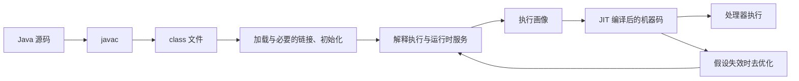
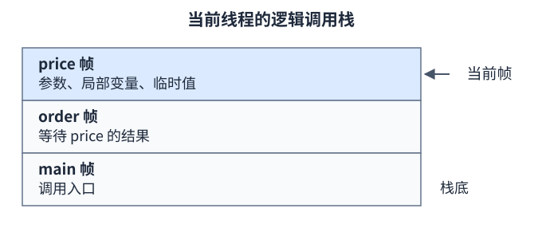

# F01：从源码到字节码、栈帧与执行

对应主课程 01、02；先读本篇，再做 `env`、`bytecode`。本篇的字节码表来自仓库的 BytecodeDemo，而非对所有编译器输出的承诺。

## 1. JVM、HotSpot 和 JDK 分别负责什么

JVM 规范描述一台抽象机器，包括指令、类型、运行时结构与合法行为。HotSpot 是具体实现；JDK 则提供 Java 运行时和 javac、java、javap、jcmd 等工具。问“JVM 是否这样实现”时，先确定是在问规范还是某个实现。

源码中的 `a + b` 经 javac 转换为 class 文件中的指令。运行时还要查找类型、完成必要的链接与初始化、执行方法。HotSpot 可以解释字节码，也可以将热点代码编译成机器码。JIT 优化不需要维持字节码里每一次变量存取的物理形态，但要维持规定的可观察行为。



这是学习用的执行路径图，不是“所有方法必须先解释固定次数”的状态机。启动参数、编译策略、AOT 缓存等都可能改变实际路径。规范并未要求实现使用解释器或 JIT。[JVMS 25 §2 的实现边界](https://docs.oracle.com/javase/specs/jvms/se25/html/jvms-2.html)

## 2. class 文件里有什么

阅读 `javap -v` 时，先找以下信息，再看指令细节：

| 部分 | 回答的问题 | 本项目中的例子 |
| --- | --- | --- |
| 文件标识与版本 | 是不是合法 class，目标虚拟机能否接受 | `javac --release 25` 产物主版本 69 |
| 常量池 | 指令引用了哪些类型、字段、方法与常量 | `compute:(II)I`、`System.out` |
| 类、父类、接口 | 类型声明了什么关系 | BytecodeDemo 的父类是 Object |
| 字段与访问标志 | 字段类型是什么，有哪些语义标记 | value 的 ACC_VOLATILE |
| 方法与描述符 | 参数和返回值如何编码 | `(II)I` 表示两个 int 参数、int 返回值 |
| 方法 Code 属性 | 方法代码、栈深约束、局部变量容量、异常处理 | `stack=2, locals=3` |
| 辅助属性 | 调试、验证和动态调用需要什么信息 | LineNumberTable、StackMapTable |

常量池中的编号只是本文件的索引。重新编译后 `#19` 可能变成别的编号，所以读反汇编要看注释所表示的成员，不应背编号。方法描述符不包含源码参数名；调试用的 LocalVariableTable 也不是执行所必需的源码变量目录。[JVMS 25 §4.1、§4.3、§4.7](https://docs.oracle.com/javase/specs/jvms/se25/html/jvms-4.html)

## 3. 一次方法调用对应一个逻辑栈帧

栈帧保存本次调用的局部变量、求值过程中的中间值，以及动态链接、返回和异常处理需要的信息。递归调用同一个方法会产生不同的调用状态；方法字节码并没有因此复制到每个栈帧里。

假设 `main → order → price`，运行 price 时可以画成：



price 正常返回后，它的结果交给调用方，order 恢复为当前调用。若 price 抛异常，则先在适用的处理器中寻找匹配项；当前方法没有匹配处理器时，退出当前调用并继续向调用方传播。正常返回与异常退出不能画成“都执行到方法最后一行”。

JIT 可以内联多个方法，所以逻辑调用、反优化所需状态和机器栈帧不一定一一对应。不要用一张解释器栈帧示意图计算所有优化代码的栈内存。

## 4. 局部变量表与操作数栈为什么分开

局部变量表按索引保存本次调用需要的值；操作数栈用于执行表达式。以本仓库代码为例：

```java
public static int compute(int a, int b) {
    int sum = a + b;
    return sum * 2;
}
```

本机 JDK 25 编译结果中，a 使用槽 0，b 使用槽 1，sum 使用槽 2。下表从 `compute(3, 4)` 的参数已进入局部变量表开始；栈以右侧为栈顶，`—` 表示该局部槽尚未由本段代码赋值。

| 指令执行后 | 槽 0 | 槽 1 | 槽 2 | 操作数栈 | 发生的变化 |
| --- | --- | --- | --- | --- | --- |
| 进入方法 | 3 | 4 | — | `[]` | 参数已就位 |
| `iload_0` | 3 | 4 | — | `[3]` | 从槽 0 取值 |
| `iload_1` | 3 | 4 | — | `[3,4]` | 从槽 1 取值 |
| `iadd` | 3 | 4 | — | `[7]` | 消费两个 int，压入和 |
| `istore_2` | 3 | 4 | 7 | `[]` | 弹出 7 存到槽 2 |
| `iload_2` | 3 | 4 | 7 | `[7]` | 再次参与计算 |
| `iconst_2` | 3 | 4 | 7 | `[7,2]` | 压入常量 2 |
| `imul` | 3 | 4 | 7 | `[14]` | 消费两个值，压入乘积 |
| `ireturn` | — | — | — | 返回 14 | 当前调用结束 |

最大同时出现两个 int 操作数，所以这里 `max_stack=2`；局部变量容量是 3。两个量都不是“字节数”。指令语义可对照 [JVMS 25 §6.5](https://docs.oracle.com/javase/specs/jvms/se25/html/jvms-6.html)。

### 槽位的四个常见追问

- 实例方法的槽 0 通常用于 `this`，本例是 static 方法，没有隐式 this。参数是否有名字不影响传递规则。
- `long`、`double` 在局部变量表中占两个连续位置；引用占一个逻辑位置。这不能推出引用在物理内存中固定为 4 字节。
- 源码变量离开作用范围后，编译器可以在后续区间复用槽。变量名、词法作用域和机器活跃区间是不同概念。
- 局部变量不会像实例字段那样自动得到可直接读取的默认值。必须满足语言的明确赋值规则；验证器也会约束合法的局部变量使用。

作用域与明确赋值分别查 [JLS 25 §6.3](https://docs.oracle.com/javase/specs/jls/se25/html/jls-6.html#jls-6.3)和 [JLS 25 §16](https://docs.oracle.com/javase/specs/jls/se25/html/jls-16.html)。对象在某行之后是否仍是 GC 活跃引用，不能仅凭源码右花括号判断。

## 5. 方法调用、构造器与同步指令

| 指令 | 常见用途 | 回答时应保留的边界 |
| --- | --- | --- |
| invokestatic | 静态方法调用 | 不需要实例接收者，但涉及目标类型的解析和必要初始化 |
| invokevirtual | 普通实例方法调用 | 语义涉及接收者类型，优化后可能去虚拟化和内联 |
| invokeinterface | 通过接口调用 | 不意味着每次都做昂贵查表，需看优化结果 |
| invokespecial | 实例初始化、某些父类和特殊实例调用 | 不能笼统说成所有 private 调用唯一固定的编译方式 |
| invokedynamic | 由引导方法链接调用点 | 常见于字符串拼接、lambda，和反射不是同义词 |

`new` 与实例初始化调用是不同字节码动作；class 文件里的 `<init>` 表示实例初始化方法。执行一个构造器与执行类的 `<clinit>` 不是一回事，详见 [F03](03-class-loading.md)。

本项目 increment 方法带 ACC_SYNCHRONIZED，而 block 方法的同步块含 monitorenter/monitorexit。同步方法的加解锁由调用语义处理，因此没看到 monitorenter 不代表没有锁。同步块的异常路径也需要释放已成功获得的 monitor；实际反汇编中可以看到异常表与释放路径。

`volatile value++` 涉及读取、加法和写回；单次 volatile 访问的语义不会把整个复合动作变成原子操作。这里是否还有 synchronized、是否使用同一把锁，要单独判断。[JLS 25 §17.1、§17.4](https://docs.oracle.com/javase/specs/jls/se25/html/jls-17.html)

## 6. 亲手验证

从仓库根目录执行：

```powershell
./scripts/run-lab.ps1 bytecode
javap -classpath labs/bytecode/target/classes -p -c -v dev.jvm.labs.BytecodeDemo
```

先手算上表，再查 `stack`、`locals`、描述符、ACC_VOLATILE、ACC_SYNCHRONIZED 和异常表。修改 compute，让它调用另一个方法，重新解释“调用方操作数栈中的参数如何对应被调用方局部变量”。

**面试自测与参考要点：**

1. **为什么栈帧不是方法本身？** 方法可以被多次、递归或多线程调用，每次需要独立的调用状态；共享方法代码与每次调用的数据应分开。
2. **long 占两个槽，是否说明 JVM 是 32 位？** 不能。逻辑局部变量规则与处理器位数、物理栈布局不是同一层。
3. **解释执行与 JIT 会同时存在吗？** 同一进程中可以有不同执行状态；说明画像、编译与去优化，不承诺固定阈值。
4. **如何证明某段代码线程安全？** 字节码帮助分解操作，但仍需同步规则、不变量和访问路径；不能仅数指令或看一次运行结果。

下一篇：[运行时内存、对象与进程预算](02-memory.md)。
