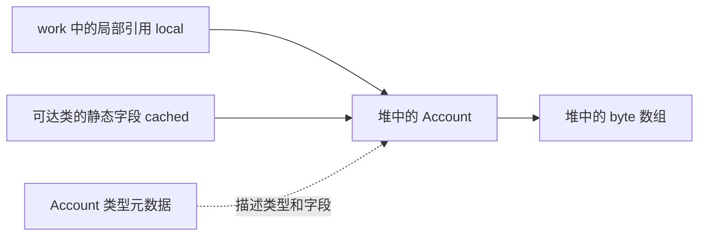

# F02：运行时内存、对象与进程预算

对应主课程 04、11。先把“哪种数据属于哪个逻辑区域”与“进程实际用了多少内存”分开，再讨论对象布局和分配优化。

## 1. 运行时区域全景

以下是规范层面的分类，不能直接当作 HotSpot 进程的连续物理地址布局。[JVMS 25 §2.5](https://docs.oracle.com/javase/specs/jvms/se25/html/jvms-2.html#jvms-2.5)

| 区域 | 主要作用 | 共享范围与生命周期 | 规范规定的相关异常 |
| --- | --- | --- | --- |
| 程序计数器 PC | 表示当前执行的 JVM 指令位置 | 每个 JVM 线程各自拥有 | 该区域没有规定 OOM 情形 |
| Java 虚拟机栈 | 保存 Java 方法调用的帧 | 线程私有，随线程存在 | StackOverflowError；创建或动态扩展失败可有 OOM |
| 本地方法栈 | 支持 native 方法等实现需要 | 实现可提供，通常按线程分配 | 栈深限制或分配失败相关的 SOE/OOM |
| 堆 | 类实例和数组的分配区域 | JVM 线程共享，随 VM 存在 | 无法满足所需分配时 OOM |
| 方法区 | 类级结构、方法信息、运行时常量池等 | 共享，随 VM 存在 | 分配无法满足时 OOM |
| 运行时常量池 | 每个类或接口的常量及符号引用的运行时表示 | 属于方法区 | 创建所需空间不足时 OOM |

共享表示可由多个线程访问，不表示该区域中的每次访问都有数据竞争。线程私有的引用变量也完全可以指向被多个线程共享的对象。

PC 是抽象机器中的状态，不等于 Java 提供了一个能直接读取的 CPU 寄存器 API。执行 native 方法时，规范不定义其 PC 值。Java 栈和本地方法栈是否映射到独立物理结构、如何与操作系统栈协作，应看具体实现。

## 2. 同时画区域图和引用图

看一个仅用于解释存储关系的片段：

```java
class Account {
    static Account cached;
    int balance;
    byte[] history = new byte[1024];

    static void work() {
        Account local = new Account();
        cached = local;
        local.balance = 10;
    }
}
```

从语言可观察行为看，work 创建 Account，history 指向另一个数组，cached 与 local 在赋值后引用同一 Account。给 local 重新赋值只改变局部引用；修改 local.balance 则修改对象字段，因此通过 cached 也能看到同一对象的字段变化。它没有创建第二个 Account。[JLS 25 §4.3.1](https://docs.oracle.com/javase/specs/jls/se25/html/jls-4.html#jls-4.3.1)



这里没有把“类元数据”“Class 对象”“静态字段值”和“字段引用的实例”画成同一个实体。对 HotSpot 而言，类元数据主要由 Metaspace 管理，Class 镜像是堆中的对象；静态字段的实际存储也不应从规范方法区定义直接推成全部位于 Metaspace。

work 返回时，它的调用状态结束；cached 若仍有可达的保留路径，Account 与 history 仍可存活。所以“方法返回”“局部变量不再使用”“对象立即被回收”不是三个等价事件。

调用帧通常随调用退出而释放相应状态，但不能说“栈与 GC 没关系”：活跃栈引用参与根扫描；虚拟线程的挂起状态还可由堆中的 stack chunk 承载。逻辑上的线程私有栈，不强制对应一块永远不受堆 GC 管理的物理内存。[jdk-25-ga stack chunk 表示](https://github.com/openjdk/jdk/blob/jdk-25-ga/src/hotspot/share/oops/stackChunkOop.hpp)

## 3. 方法区、Metaspace、永久代与 Code Cache

| 词 | 所属层次 | 应怎样使用 |
| --- | --- | --- |
| 方法区 | JVMS 逻辑区域 | 描述类级信息等运行时结构 |
| Metaspace | 现代 HotSpot 的元数据内存管理 | 分析类元数据使用和加载器生命周期 |
| PermGen 永久代 | 旧 HotSpot 实现 | 只解释旧版本现象，JDK 25 不使用 PermSize 参数 |
| Code Cache | HotSpot 执行实现 | 保存编译代码等，分析编译与代码缓存压力 |
| Class 对象 | Java 堆中的类镜像对象 | 反射、静态同步锁等 Java 层操作 |

规范不要求方法区必须对应一块独立的本地内存，不要求采用 Metaspace，也不要求方法区一定做压缩回收。HotSpot 的诊断类别与规范区域不存在必须逐项相等的关系。

类元数据、interned String 和静态变量的历史迁移可对照 [JEP 122](https://openjdk.org/jeps/122)。迁移至本地内存或 Java 堆的项目需要分别理解，不能把旧永久代框中的所有东西一起改名为 Metaspace。

元空间参数还要区分：`MaxMetaspaceSize` 是上限约束；`MetaspaceSize` 影响触发元数据 GC 的初始高水位，并不是预先分配的固定元空间大小。参数说明见 [java 25 命令](https://docs.oracle.com/en/java/javase/25/docs/specs/man/java.html)。

## 4. 三种“池”不要混用

| 名称 | 解决什么问题 | 例子 |
| --- | --- | --- |
| class 文件常量池 | 编码文件中的常量及符号关系 | javap 中的 Class、Methodref、Utf8 |
| 运行时常量池 | 支持类型加载后的解析和执行 | 某类的方法引用经解析后可用于调用 |
| 字符串驻留池 | 对相同内容的字符串提供规范化共享 | String.intern 返回驻留表示 |

String 是对象，不会因为被 intern 就变成 Metaspace 中的“非对象”。`new String("xy")` 的包装实例与字面量的共享对象要分开；源码中几处字符串构造、运行时最终保留了几个对象、JIT 是否消除分配，也要分开问。[String 25 的 intern 契约](https://docs.oracle.com/en/java/javase/25/docs/api/java.base/java/lang/String.html#intern())

## 5. 对象从创建语义到分配路径

以普通对象创建为例，可以依次问：目标类是否完成必要初始化；对象需要多大空间；怎样满足字段默认值；构造器如何执行；引用何时交给调用方。源码默认值、显式字段初始化、构造器赋值是不同步骤。[JLS 25 §12.5](https://docs.oracle.com/javase/specs/jls/se25/html/jls-12.html#jls-12.5)

HotSpot 的常见分配快路径会在线程的 TLAB 中推进分配指针。TLAB 是已经分给线程使用的**堆内分配缓冲区**，不是线程栈；线程私有的是分配管理，不是把对象永久标记为“只有这个线程能读”。对象发布后仍可能被其他线程访问。

TLAB 用尽后可能重新申请缓冲区、走共享分配慢路径、触发 GC 或最终失败。大对象、不同收集器及优化后的代码不必走相同路径。所以以下推断不成立：`new → 必定进入当前线程的 TLAB → 必定进入 Eden → 必定经历 15 次 GC`。

引用怎样定位对象也是实现问题。规范不规定必须采用“句柄 → 对象”的两级结构或裸地址；HotSpot 使用对象指针、压缩引用等表示，具体收集器还可能引入编码和访问屏障。对象会移动时如何修正引用，必须结合该实现分析，不能仅凭 reference 这个逻辑类型画出唯一物理结构。[jdk-25-ga oop 表示](https://github.com/openjdk/jdk/blob/jdk-25-ga/src/hotspot/share/oops/oop.hpp)

对 HotSpot 实现的进一步验证可读 [jdk-25-ga 的 TLAB 源码](https://github.com/openjdk/jdk/blob/jdk-25-ga/src/hotspot/share/gc/shared/threadLocalAllocBuffer.cpp)。

## 6. 对象到底多大

学习时可以先用这个计算模型：

```text
浅大小 ≈ 对齐(对象头 + 实例字段布局所占空间)
数组浅大小还需考虑数组长度和元素存储
```

它是估算方法，不是规范承诺。对象头模式、引用压缩、对象对齐和字段布局都会影响结果。本项目通过 Instrumentation.getObjectSize 观察实现相关的浅大小；它不递归统计引用的对象。

例如一个壳对象持有 1 KiB 数组：壳的 shallow size 与数组的 shallow size 分开。retained size 还取决于引用图：若数组也被别的根路径保留，删掉这个壳并不能使数组一并回收。因此保留大小不能一律用“自己加上所有能访问的对象”计算。

```powershell
./scripts/run-lab.ps1 layout
./scripts/run-lab.ps1 layout -JvmArgs @('-XX:+UseCompactObjectHeaders')
```

实验要记录 JDK 构建、传统/紧凑头模式、指针压缩与对齐条件，再解释 Empty、OneInt、Reference 和数组结果。不要把一次 16→8 字节的变化当成所有类型都节省 8 字节。[JEP 519](https://openjdk.org/jeps/519)

## 7. 源码中有对象，不等于优化后一定分配对象

如果一个对象只在可分析的局部计算中使用，JIT 可能将字段替换为可独立优化的值，消除整个对象分配。这与“先在堆上分配，再搬到栈上”不是同一件事。

```powershell
./scripts/run-lab.ps1 jit
./scripts/run-lab.ps1 jit -JvmArgs @('-XX:-DoEscapeAnalysis')
```

比较 localBytes 与 escapingBytes，同时检查编译活动。这个实验支持对分配消除的判断，但不能仅凭近零计数证明发生了某种物理栈上分配，也不是正式的吞吐基准。

## 8. 堆预算和进程预算

设一个教学用容器预算为 512 MiB，Java 最大堆 64 MiB。两者之间的余量仍需容纳元数据、Code Cache、线程栈、直接内存、GC 辅助结构、JFR 和其他本地开销；这只是预算分项，不保证所有程序都够用。

| 指标 | 描述 | 不能直接推出什么 |
| --- | --- | --- |
| reserved | 预留的虚拟地址范围 | 不等于已经使用同等物理内存 |
| committed | 对应内存类别已提交的容量 | 不等于该类别当前全部驻留物理内存 |
| used | 该统计口径中正在使用的部分 | 不等于整个进程用量 |
| RSS | 操作系统观察的驻留内存 | 不等于 Java 堆 used |
| Xmx | Java 堆上限参数 | 不约束整个进程的所有本地内存 |

NMT 用于解释 HotSpot 跟踪的本地内存类别，不是任意 native 库分配的完整账本，也不能替代 OS/容器统计。[JDK 25 NMT 说明](https://docs.oracle.com/en/java/javase/25/troubleshoot/diagnostic-tools.html)

**面试自测与参考要点：**

1. **栈中的引用是否意味着对象也在栈上？** 不意味着；先说明逻辑引用与实例，再说明优化可能消除分配。
2. **共享堆为什么还能有线程本地分配？** TLAB 从共享堆划出分配缓冲区；降低分配竞争不等于取消对象共享。
3. **方法区就是 Metaspace 吗？** 前者是规范概念，后者是 HotSpot 元数据实现；Class 对象和静态字段也不能全部塞进元空间图。
4. **Xmx 加倍能解决所有 OOM 吗？** 不能；必须区分堆、元空间、直接内存、线程资源和容器限制。
5. **对象有引用就一定不会回收吗？** 还要看该引用是否来自根可达的对象、是否是强可达路径，见 F04。

下一篇：[类加载、链接、初始化与卸载](03-class-loading.md)。
