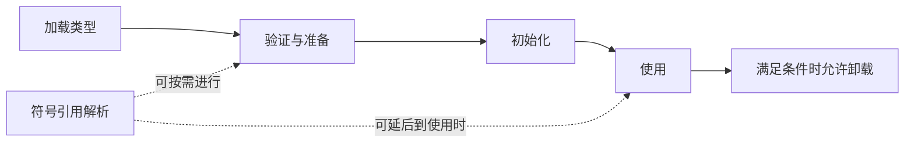

# F03：类加载、链接、初始化与卸载

**导航：** [学习路线](../README.md) · [第 03 章](../CURRICULUM.md#第-03-章类加载初始化与类身份)

对应主课程 03。学习目标是看一段代码就能区分“需要找到类型”“需要准备类型”“需要执行静态初始化”，再解释类加载器怎样影响类型身份。

## 1. 生命周期图怎样读



链接包含验证、准备、解析。但图中的顺序不能被读成“所有常量池条目必须全部解析完毕才能开始初始化”。实现可以采用不同解析策略，同时必须满足规范的时序与错误行为要求。[JVMS 25 §5.4](https://docs.oracle.com/javase/specs/jvms/se25/html/jvms-5.html#jvms-5.4)

| 阶段 | 做什么 | 不要混淆成什么 |
| --- | --- | --- |
| 加载 | 根据二进制表示创建类型的运行时表示 | 不等于执行全部静态代码 |
| 验证 | 检查文件结构、类型使用和字节码约束等 | 不保证业务代码没有死锁或无限循环 |
| 准备 | 创建静态字段等必要存储，设置默认值 | 不是执行任意显式赋值表达式 |
| 解析 | 将符号引用转成实现可使用的运行时引用 | 不是处理源码 import，也不必是写入裸地址 |
| 初始化 | 按规则处理常量值和执行静态初始化方法 | 与每个实例的构造器不同 |
| 卸载 | 满足条件时释放类型相关资源 | 不等于某个业务实例被回收 |

## 2. 准备、ConstantValue 与普通静态赋值

考虑下面的教学片段：

```java
class Config {
    static int count = 3;
    static final int LIMIT = 7;
    static final Integer BOXED = 7;
    static final int PARSED = Integer.parseInt("7");
    static {
        count = 5;
    }
}
```

对 count，准备阶段提供 int 默认值 0；执行初始化中的普通静态赋值后先为 3，再经静态块变为 5。这里讨论的是赋值顺序，不是在说字段一定放在某块具体物理区域。

LIMIT 是基本类型 final 变量，初始化表达式也是常量表达式。常量变量也可以是 String 类型，但仍需要 final 和常量表达式等条件。BOXED 的类型是 Integer；PARSED 的初始化调用了方法，因此它们不满足这里的常量变量条件。`final` 约束赋值，不等于“一定在编译期知道值”。常量变量的语言定义见 [JLS 25 §4.12.4](https://docs.oracle.com/javase/specs/jls/se25/html/jls-4.html#jls-4.12.4)。

**一个经常被旧材料讲错的阶段细节：** 按 JVMS 25 §5.5 的初始化过程，带 ConstantValue 属性的静态字段在执行该类型的 `<clinit>` 前得到相应常量值。不能把它们笼统描述成“准备阶段执行显式赋值”。准备阶段的默认初始化、ConstantValue 处理、编译器生成的 putstatic 是三件不同的事。

引用 LIMIT 的 Java 使用方通常直接包含常量值，不需要在运行时读取 Config.LIMIT。因此“访问了类名限定的字段”不必然触发这个类初始化。若独立发布库时只更新常量定义、不重新编译使用方，旧使用方可能继续使用旧值；这是常量内联的工程后果。[JLS 25 §13.1](https://docs.oracle.com/javase/specs/jls/se25/html/jls-13.html#jls-13.1)

## 3. `<clinit>` 与 `<init>`

| 名称 | 含义 | 常见触发与次数 |
| --- | --- | --- |
| `<clinit>` | 类或接口初始化方法 | 该类型初始化时执行；是否生成取决于需要 |
| `<init>` | 实例初始化方法 | 创建实例并调用对应构造器时执行，可有不同描述符 |

`<clinit>` 常由普通静态字段赋值和静态块组成，按相应声明顺序执行。它不是一个可以像普通方法一样从 Java 直接调用的“静态构造器”。没有需要执行的初始化代码时，类型可以没有这个方法，但依然有初始化状态。

构造器处理实例初始化，可能通过 this 或 super 调用连接到其他实例初始化方法。JDK 25 的构造器规则已支持受约束的前置语句，不应再背“任何构造器的第一条源码语句只能是 super/this”。具体限制查 [JLS 25 §8.8.7](https://docs.oracle.com/javase/specs/jls/se25/html/jls-8.html#jls-8.8.7)。本项目基础实验使用普通构造方式，不依赖这项语法扩展。

## 4. 哪些操作会触发初始化

下面按常见 Java 使用方式理解；完整触发规则还包括特定 MethodHandle 使用、运行时启动等情况，以规范清单为准。

| 操作 | 是否会因此要求初始化目标类型 | 原因 |
| --- | --- | --- |
| 首次 new 普通类实例 | 是 | 创建实例前需要完成必要初始化 |
| 调用该类声明的静态方法 | 是 | invokestatic 相关的主动使用 |
| 读取/写入其声明的非编译期常量静态字段 | 是 | 按实际声明字段的类型判断 |
| 读取 Java 编译期常量变量 | 不因这次读取触发 | 使用方可直接使用内联值 |
| `SomeType.class` | 不因类字面量触发 | 得到 Class 对象与初始化不是一回事 |
| `new SomeType[10]` | 不因创建数组触发元素类初始化 | 创建的是数组对象 |
| `Class.forName(name)` | 通常会 | 这个重载要求初始化 |
| `Class.forName(name, false, loader)` | 不要求在本次调用中初始化 | 显式传入 false |

类初始化之前需要初始化其父类，还涉及声明 default 方法的某些超接口；初始化接口本身不等于递归初始化全部父接口。“父类先初始化”是有用的主线，但不能扩展成“所有实现接口都先初始化”。[JLS 25 §12.4.1、§12.4.2](https://docs.oracle.com/javase/specs/jls/se25/html/jls-12.html#jls-12.4)

## 5. 用现有实验逐行预测

```powershell
./scripts/run-lab.ps1 init
./scripts/run-lab.ps1 init -JvmArgs @('-Xlog:class+load=info,class+init=info')
```

输出主线如下，具体 VM 日志穿插位置另行记录：

```text
constant=7
after passive use
Target initialized
runtime=9
Parent initialized
inherited=11
```

第一行来自常量值；显式的 `Class.forName(..., false, ...)` 加载行为不要求初始化。读取 runtime 才需要执行 Target 的静态逻辑。`Child.value` 的 value 声明在 Parent，所以会初始化 Parent，不会仅因此初始化 Child。

推演时分两列记录“源代码做了什么”与“实际声明方是谁”。再把 CONSTANT 的初始化改成 `Integer.parseInt("7")`，重新编译所有使用方，预测输出顺序；仅改 final 字样不是同一个对照条件。

## 6. 初始化的并发、递归与失败

运行时协调同一类型的初始化状态，避免多个线程同时重复执行它的普通静态初始化逻辑。其他线程可能等待初始化完成；初始化线程自己的递归请求有专门处理规则，不是简单再次进入 `<clinit>`。跨类型的初始化依赖也可能造成阻塞甚至死锁。

如果初始化异常完成，类型会进入错误状态。首次发起者可能看到 ExceptionInInitializerError；若原始异常本来就是 Error，传播规则又不同。以后在同一加载器定义的同一类型上尝试初始化，可能得到 NoClassDefFoundError，根因却不是 class 文件不在磁盘上。

诊断时保留首次异常和 causes，不能只看最后一次报错。修改配置后在同一 VM 中再次“重试读取静态字段”，也不是重新运行该类型初始化的通用方式。[JVMS 25 §5.5](https://docs.oracle.com/javase/specs/jvms/se25/html/jvms-5.html#jvms-5.5)

## 7. JDK 25 的加载器层次与父委派

常见内置关系可以先画为“应用加载器 → 平台加载器 → 启动加载器”。这是委派关系，不是 Java 类继承关系；自定义加载器可以有自己的父加载器和策略。

| 加载器 | 学习重点 | 旧版本材料需要修正的部分 |
| --- | --- | --- |
| Bootstrap | 核心运行时类型；在 getClassLoader 中常用 null 表示 | null 不表示类型没加载 |
| Platform | 平台类型的可见性与加载 | 不沿用 Extension 加载器和 ext 目录模型 |
| System/Application | 应用 class path、模块等 | 不假定实现一定是 URLClassLoader |
| 自定义加载器 | 数据来源、定义策略、隔离与生命周期 | 同名类是否同一类型要看定义加载器 |

标准 ClassLoader 的加载逻辑可以概括为：先查已经加载的类型，再委派父加载器，父侧找不到时调用本加载器的查找逻辑。开发时通常优先扩展 findClass，而不是不加约束地重写全部 loadClass。模块化的可见性还可能使实际委派关系比这条简图复杂。[ClassLoader 25 API](https://docs.oracle.com/en/java/javase/25/docs/api/java.base/java/lang/ClassLoader.html)

## 8. 同名、同字节，也可能不是同一类型

本项目 loader 实验用两个独立加载器定义相同二进制名称的 Payload。可以把类型写为 `(名称, 定义加载器)`：

```text
A = (dev.jvm.labs.ClassIdentityDemo$Payload, loader-1)
B = (dev.jvm.labs.ClassIdentityDemo$Payload, loader-2)
```

名称相同、文件内容相同，只能说明它们的名称和定义字节相同，不能使 A 和 B 自动成为一个类型。实例从 B 转为 A 时失败。String 则继续父委派，因此两侧使用同一个核心类型。

```powershell
./scripts/run-lab.ps1 loader
```

**定义加载器**实际创建类型；**发起加载器**发起加载请求，可能通过委派得到其他加载器定义的类型。框架异常中的 “X cannot be cast to X” 要连同加载器标识分析，而不是只比类名。

父委派减少重复定义和核心类型不一致，但不是 JVM 要求一切加载永远只能父优先的定律。SPI/TCCL 为父侧框架寻找业务实现提供另一条可见性路径；不能因此推成“所有类都应该子优先”。

## 9. 对象回收与类卸载不同

一个实例不再存活，不说明它的类立即可卸载。JLS 对类卸载约束涉及定义加载器是否可被回收；由 bootstrap 加载的类不能按此方式卸载。[JLS 25 §12.7](https://docs.oracle.com/javase/specs/jls/se25/html/jls-12.html#jls-12.7)

热部署中常见保留路径是：存活线程 → 上下文加载器 → 旧业务类型，或外部缓存 → 业务 Class/实例 → 旧加载器。卸载需要移除这些跨生命周期的保留关系。单独释放一个局部 loader 变量，不能保证所有间接关系都消失。

观察类数量、加载器数量、卸载日志与 heap dump 根路径，再做多轮部署验证。System.gc 是请求，一次没有卸载不能证明根路径必然有泄漏。

**面试自测与参考要点：**

1. **为什么读取 Child.value 没打印 Child initialized？** 先找字段声明方；本例只要求 Parent 初始化。
2. **final 字段都在准备阶段赋好显式值吗？** 不对。区分默认初始化、常量变量、ConstantValue 与普通静态初始化代码。
3. **双亲委派能被打破吗？** 是可定制的加载策略，但核心类型、加载约束和模块访问仍有边界；举 SPI 和隔离加载器的不同目的。
4. **ClassNotFoundException 与 NoClassDefFoundError 有什么区别？** 前者常来自显式查找失败；后者可能是依赖定义或初始化失败等，必须追溯根因。
5. **类卸载能解决 ThreadLocal 或线程泄漏吗？** 要先切断保留路径；卸载是可能的结果，不是替代生命周期管理的动作。


---

[学习路线](../README.md) · [返回本章验收](../CURRICULUM.md#第-03-章类加载初始化与类身份) · [下一章：04 内存与对象布局](../CURRICULUM.md#第-04-章内存区域对象布局与分配路径)
