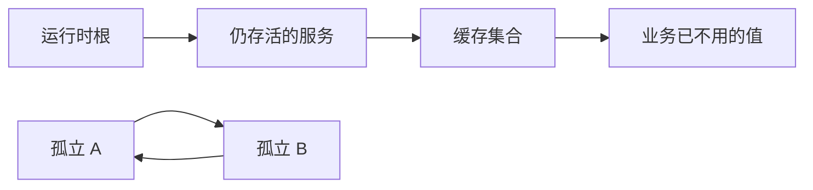
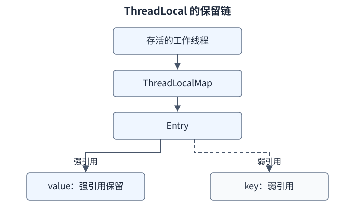

# F04：可达性、引用与资源生命周期

**导航：** [学习路线](../README.md) · [第 05 章](../CURRICULUM.md#第-05-章可达性引用与资源生命周期)

对应主课程 05。核心问题不是“某变量设为 null 没有”，而是“运行时还能从哪些起点沿哪些边访问这个对象”。

## 1. 为什么不能只数引用

假设 A.next 指向 B，B.next 指向 A，创建它们的方法已经返回，外部没有任何强引用路径。它们互相引用，但业务已经无法到达它们。简单的引用计数会被这个环卡住；追踪式 GC 可以通过根可达性识别这个孤立子图。



左侧 V 可能造成保留泄漏：程序不需要它，但仍有根路径。右侧环可以回收。判断对象是否“有用”属于业务；GC 基于运行时可达性，不会自动理解订单已经过期。

这里用简化图解释强可达关系；软、弱、虚引用和终结处理会引入更细的可达性状态。完整术语见 [java.lang.ref 25 包说明](https://docs.oracle.com/en/java/javase/25/docs/api/java.base/java/lang/ref/package-summary.html)。

## 2. GC Roots 到底是什么

Roots 是追踪开始的外部入口。学习 HotSpot 时，应能识别这些典型来源，而不是背“所有对象引用都是 root”：

| 常见来源 | 如何形成路径 | 判断时的限制 |
| --- | --- | --- |
| 执行线程中的活跃引用 | 当前调用仍需要使用的对象 | 源码变量仍在作用域不保证其始终保持 GC 活跃 |
| JNI 等本地引用 | 本地代码持有的局部或全局引用 | 有各自的引用类型和释放规则 |
| VM 内部和运行时代码相关引用 | 运行时继续执行所需的对象 | 属于具体实现的根扫描机制 |
| 从可达类静态状态出发的关系 | 静态缓存 → 集合 → value | 不能推成每个静态字段永久阻止类卸载 |

实例字段通常是一条边。`node.next` 只有在 node 本身可达时，才沿着这条强边保持 next 对象可达。自定义加载器、类镜像、静态字段和实例也可能形成一个整体可回收的子图，所以不能把静态字段粗暴画成无条件永久 root。

G1 在局部收集时还会使用来自收集集合之外的引用作为扫描入口。那里的 heap roots 与“从整个 VM 外部开始的根”有不同讨论范围，详见 [G1 25 的收集过程](https://docs.oracle.com/en/java/javase/25/gctuning/garbage-first-g1-garbage-collector1.html)。

## 3. 四类引用怎样区分

| 类型 | 典型表达 | 对目标对象意味着什么 | 不应许诺什么 |
| --- | --- | --- | --- |
| 强引用 | 普通对象字段、局部引用等 | 强可达时不能按垃圾处理 | 给一个局部赋 null 就能移除所有强路径 |
| 软引用 | SoftReference | 内存敏感的引用处理策略 | 稳定缓存容量、固定回收顺序和稳定命中率 |
| 弱引用 | WeakReference | 不会仅靠这条边把目标保持为强可达 | 任何一次 gc 请求后立刻清空并入队 |
| 虚引用 | PhantomReference | 参与回收后的清理协调与通知 | get 能取回目标、清理一定及时完成 |

Reference 对象本身也是普通对象。需要通知时通常要保持 Reference 对象和关联登记信息可达，不能只创建一个临时弱引用或虚引用，就期待未来总能从队列拿到它。

软引用契约还规定：仅软可达对象的软引用会在 VM 抛 OOM 前被清除，但这不是“使用软引用就永远不会 OOM”的保证。强可达数据、其他资源限制和回收后仍不足的空间仍可能造成失败。弱引用在识别到弱可达时清除，入队可以同时或稍后发生；虚引用的 get 则始终返回 null。分别核对 [SoftReference](https://docs.oracle.com/en/java/javase/25/docs/api/java.base/java/lang/ref/SoftReference.html)、[WeakReference](https://docs.oracle.com/en/java/javase/25/docs/api/java.base/java/lang/ref/WeakReference.html)和 [PhantomReference](https://docs.oracle.com/en/java/javase/25/docs/api/java.base/java/lang/ref/PhantomReference.html)，不要把四类引用背成固定倒计时。

`clear`、`get`、队列通知等操作有各自契约，不能由名字猜时序。尤其是目标已清空与 Reference 已出现在队列中，不能作为同一个瞬时事件处理。[Reference 25 API](https://docs.oracle.com/en/java/javase/25/docs/api/java.base/java/lang/ref/Reference.html)

## 4. 用 references 实验区分三个观察

```powershell
./scripts/run-lab.ps1 references
./scripts/run-lab.ps1 references -JvmArgs @('-Xlog:gc')
```

先画对象环，再运行。检查：程序是否完成了 GC 请求；弱引用是否已被清空；引用是否已被观察到入队。日志和程序输出回答的问题不同。

一个合理的预测是：没有强根路径的环具备回收条件，常见运行会观察到清空和入队。一个不合理的保证是：调用 System.gc 后下一条语句一定得到两个 true。

对照练习：给其中一个 Node 增加静态强保留路径；再运行，检查另一个节点是否也随环被保留。删除保留路径后再检查，但仍采用有界等待，不把瞬时时序写成确定性测试。

System.gc 的契约是请求运行时努力回收，不承诺某个特定对象在特定时间回收。[System.gc 25](https://docs.oracle.com/en/java/javase/25/docs/api/java.base/java/lang/System.html#gc())

## 5. “变量不用了”为什么不好观察

看这个分析片段：

```java
Object value = weak.get();
if (value != null) {
    consume(value);
}
```

如果 get 返回非 null，value 在被实际使用时提供了强引用。监测代码本身可能改变可达性，因此“我不停取出目标，观察它何时消失”不是完全被动的观测。

同样，源码变量的生命周期、优化后的活跃区间、调试器为了展示变量而保留的状态可能不同。少量 println、调试断点或不同编译状态都可能影响观察，不能据此修改可达性的定义。

需要保证本地资源操作期间某个拥有者仍可达时，可研究 Reference.reachabilityFence 的精确用途；它不是让对象永久存活或修复任意线程安全问题的工具。[reachabilityFence 契约](https://docs.oracle.com/en/java/javase/25/docs/api/java.base/java/lang/ref/Reference.html#reachabilityFence(java.lang.Object))

## 6. 两类典型保留链

### 静态集合

```text
存活的应用上下文 → 静态缓存 → Map.Entry → 大数组
```

即使业务请求已经结束，这条路径仍可能存在。应该检查缓存键的生命周期、容量、逐出条件和显式清理；仅在创建数组的方法末尾把局部变量设为 null 不会清除缓存项。

### ThreadLocal



key 变成弱可达并被清空，并不自动切断 Entry 对 value 的强引用。线程池线程长时间存在时，value 可能超过一次请求的生命周期。因此要在合适的 finally 中 remove，并避免把线程本地上下文误当成请求结束后自然销毁的普通局部变量。

这是对 HotSpot/OpenJDK 常用实现的解释，可核对 [jdk-25-ga ThreadLocal](https://github.com/openjdk/jdk/blob/jdk-25-ga/src/java.base/share/classes/java/lang/ThreadLocal.java)。诊断结论仍需 heap dump 中的实际保留路径支持。

## 7. 回收内存不等于释放外部资源

文件句柄、socket、数据库连接和 native 资源有外部生命周期。应在明确的使用边界关闭，优先使用 try-with-resources。Cleaner 可作为某些清理机制的后备，不提供业务要求的及时性。

finalization 已被弃用并计划移除，不应设计依赖 finalize 的新实验来实现资源管理；对象复活也不是生产恢复手段。[JEP 421](https://openjdk.org/jeps/421)、[Cleaner 25](https://docs.oracle.com/en/java/javase/25/docs/api/java.base/java/lang/ref/Cleaner.html)

旧面试材料中的“对象死亡一定经过两次标记、调用 finalize 后再判定”不是所有对象和收集器的统一执行流程。应先解释可达性，再在特定 finalization 语境下讨论处理过程；不能把已弃用机制当成现代 Java 自动释放资源的正常路径。

内存泄漏通常表现为无用对象仍被保留；资源泄漏还可能发生在堆占用并不高的情况下。只看 Xmx 或堆曲线不足以排除文件描述符、连接或直接内存问题。

## 8. 从“内存涨了”走向证据

1. 对齐负载和时间窗口，区分分配峰值与回收后存活集持续增长。
2. 找增长的对象种类；再检查谁保留它们，而不只看实例数量排行榜。
3. 分析 dominator 和到 GC Roots 的路径，区分浅大小与保留大小。
4. 切断一条明确的业务保留链，重放相同负载，观察多轮之后是否稳定。

可用 diagnose 的 retention 模式练习工具，但它只保留有限的约 24 MiB payload，不能把其稳定上限说成无限泄漏。

```powershell
./scripts/run-lab.ps1 diagnose -JvmArgs @('-XX:NativeMemoryTracking=summary') -LabArgs @('retention','120')
# 另一终端，替换为实际 PID
$labPid = 12345
jcmd $labPid GC.class_histogram
jcmd $labPid GC.heap_dump build/retention-check.hprof
```

直方图/heap dump 有采集成本，某些操作会触发 GC；先查目标 JVM 的命令帮助并记录采样条件，不把采集后的状态误当作采集前瞬时状态。[JDK 25 jcmd](https://docs.oracle.com/en/java/javase/25/docs/specs/man/jcmd.html)

**面试自测与参考要点：**

1. **循环引用为什么可以回收？** 追踪的是从根可达的图；孤立环中的内部引用不会凭空创造根路径。
2. **软引用和弱引用的区别是什么？** 说明可达性与回收处理策略，再说明两者都没有业务要求的固定回收时间保证。
3. **局部变量设 null 就能防泄漏吗？** 只切断该条引用；静态缓存、线程和外部持有者可能仍保留对象。
4. **为什么 weak key 没防住 ThreadLocal value 保留？** key 和 value 是不同边，需说明存活线程到 value 的完整路径。
5. **不可达是否就立刻回收？** 不是；具备条件、收集器识别、引用处理、实际回收有不同时间点。


---

[学习路线](../README.md) · [返回本章验收](../CURRICULUM.md#第-05-章可达性引用与资源生命周期) · [下一章：06 GC 基础](../CURRICULUM.md#第-06-章gc-共性分代屏障与停顿)
