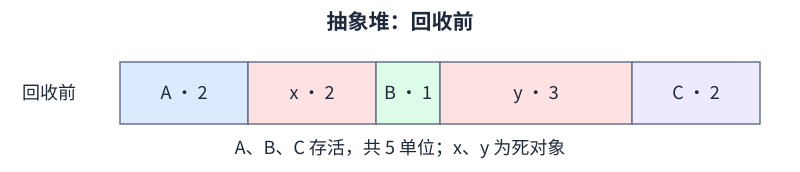
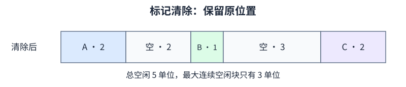
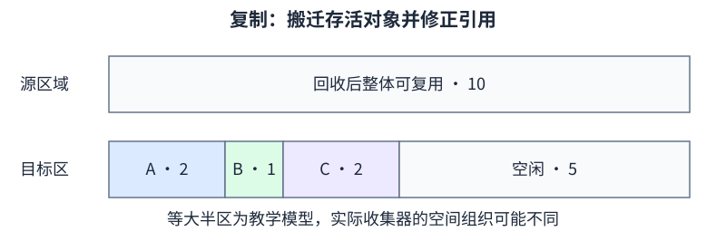
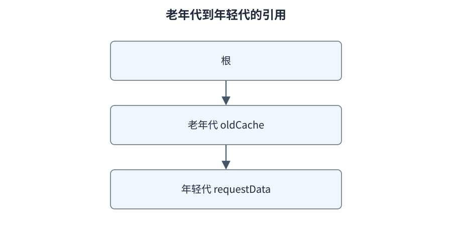

# F05：GC 算法、分代与现代收集器

**导航：** [学习路线](../README.md) · [第 06 章](../CURRICULUM.md#第-06-章gc-共性分代屏障与停顿)

对应主课程 06、07。先分清“如何认定存活”“如何释放空间”“怎样组织堆”“何时暂停应用”四个问题，再讨论具体收集器。

## 1. GC 算法不由 JVMS 指定

JVMS 规定自动存储管理等抽象要求，具体算法、内存布局和优化由实现决定。复制、标记清除、标记整理是理解不同实现的工具，不是“Java 规范要求依次执行的三步”。[JVMS 25 的实现边界](https://docs.oracle.com/javase/specs/jvms/se25/html/jvms-2.html)

| 维度 | 回答的问题 | 例子 |
| --- | --- | --- |
| 存活判定 | 哪些对象还需要保留 | 根可达性、引用处理 |
| 空间回收策略 | 死对象占据的空间怎样重新使用 | sweep、copy、compact |
| 堆组织 | 哪部分对象一起管理 | 年轻/老年代、region |
| 执行协调 | 收集工作与应用怎样交错 | STW、并行、并发 |
| 触发与目标 | 何时开始、怎样控制成本 | 分配压力、占用阈值、停顿目标 |

讨论“某算法好不好”时应指出它在哪个维度做取舍，不能直接把算法名称当作完整收集器。

## 2. 标记清除、复制、标记整理

用下面的抽象堆练习，数字表示连续空间单位，x/y 表示死对象。假设本模型要求对象连续分配、不能扩容；它不是某个真实 GC 的输出。

[](https://raw.githubusercontent.com/chuanhui2020/jvm-deep-dive/main/docs/assets/diagrams/gc-before.svg)

[打开大图](https://raw.githubusercontent.com/chuanhui2020/jvm-deep-dive/main/docs/assets/diagrams/gc-before.svg)

### 标记清除

识别存活者后，释放 x 和 y 的空间，不要求搬动 A/B/C：

[](https://raw.githubusercontent.com/chuanhui2020/jvm-deep-dive/main/docs/assets/diagrams/gc-mark-sweep.svg)

[打开大图](https://raw.githubusercontent.com/chuanhui2020/jvm-deep-dive/main/docs/assets/diagrams/gc-mark-sweep.svg)

总空闲 5，但最大连续空闲块是 3。因此在这个模型里，申请连续 4 单位仍失败。问题是空间形态，不是总空闲算错。实际分配器会使用空闲链表、合并等机制，不能把该模型当成所有 GC 的 OOM 条件。

### 复制

把存活者复制到另一块可用空间，更新引用，整块回收原区域：

[](https://raw.githubusercontent.com/chuanhui2020/jvm-deep-dive/main/docs/assets/diagrams/gc-copying.svg)

[打开大图](https://raw.githubusercontent.com/chuanhui2020/jvm-deep-dive/main/docs/assets/diagrams/gc-copying.svg)

工作量与存活对象及引用处理有关。对象大多死亡时，可以避免为每个死对象逐个做复杂回收；存活率高时，复制成本和目标空间压力增加。

学习用的等大半区复制模型会预留另一半作为目标，但不能由此推成“所有复制收集器永远只能用一半堆”。Eden/Survivor、region evacuation 都有自己的空间组织。

### 标记整理

先识别存活者，再安排移动、修正引用并形成更集中的空闲空间：

[](https://raw.githubusercontent.com/chuanhui2020/jvm-deep-dive/main/docs/assets/diagrams/gc-compaction.svg)

[打开大图](https://raw.githubusercontent.com/chuanhui2020/jvm-deep-dive/main/docs/assets/diagrams/gc-compaction.svg)

它能改善碎片，但要付出搬迁和引用修正成本；具体实现可能采用多种阶段和并行方案，不能把“整理”理解成只改一个指针。

### 比较时应说清什么

| 策略 | 主要收益 | 主要代价或限制 |
| --- | --- | --- |
| 标记清除 | 可避免搬动存活对象 | 空闲块形态、分配管理、扫描成本 |
| 复制 | 目标区紧凑，适合低存活率场景 | 搬迁成本和目标空间要求 |
| 标记整理 | 改善碎片、形成连续空闲 | 对象移动、引用修正与协调成本 |

三个模型都省略了根扫描、弱引用处理、并发修改和分配器细节。真正的收集器会组合使用策略，下一步应看它在年轻代、老年代和回退路径中的具体应用。

## 3. 为什么分代通常有效

许多应用中，大量对象只存活很短时间，集中处理这部分对象可以降低反复扫描长寿命对象的成本。这是经验性工作负载假设，不是每个对象必须遵守的寿命规律。[JDK 25 分代 GC 说明](https://docs.oracle.com/en/java/javase/25/gctuning/garbage-collector-implementation.html)

最容易学习的传统分代模型是年轻代与老年代；年轻代再分 Eden、Survivor from 和 Survivor to。一次年轻收集可概括为：

1. 在根引用和跨代引用等入口中识别本次需要保留的年轻对象。
2. 将存活者复制到目标 Survivor，或按年龄、容量和策略晋升老年代。
3. 回收源区域，交换 from/to 的角色。

```text
收集前：Eden 有新对象；S-from 有上轮幸存对象；S-to 作目标
收集中：存活者 → S-to 或 Old；修正指向移动对象的引用
收集后：原 Eden 和 S-from 可重新使用；两个 S 角色交换
```

from/to 表示当次角色，不是两个永不变更的“年龄层”。对象年龄不是创建后经过的秒数，也不是全进程所有 GC 事件的统一计数。

一个对象可能因为目标空间不足等原因提前晋升；大对象也可能绕过普通年轻分配路径。达到某个年龄上限只是策略的一部分，不能承诺每个对象都在年轻代复制固定 15 次。

传统分代模型用于建立直觉；G1 的这些角色由多个 region 承担，ZGC 则有自己的分代和并发搬迁机制。不要把固定 Eden:S0:S1 比例作为所有现代收集器的统一模型。

## 4. 年轻代 GC 为什么还要关注老年代

假设老对象 oldCache 引用了年轻对象 requestData：

[](https://raw.githubusercontent.com/chuanhui2020/jvm-deep-dive/main/docs/assets/diagrams/old-to-young-reference.svg)

[打开大图](https://raw.githubusercontent.com/chuanhui2020/jvm-deep-dive/main/docs/assets/diagrams/old-to-young-reference.svg)

如果年轻收集只从线程局部引用出发，又不识别 oldCache 的跨代边，可能漏掉仍在使用的 requestData。每次扫描全部老年代又太昂贵，于是需要维护“哪些位置可能有指向收集范围内的引用”的信息。

写屏障是引用改写等动作周围的实现逻辑；卡表是记录堆小块状态的结构；记忆集用来帮助定位外部到目标范围的引用。三者相关，但不是同义词，也不是 Java 的 synchronized 内存屏障可以直接替代的概念。

JDK 25 的 G1 还可能以 region 组维护记忆集，别把旧图中的“每 region 必有完全独立且固定结构的 RSet”当成永久实现细节。[G1 25 的 Remembered Set](https://docs.oracle.com/en/java/javase/25/gctuning/garbage-first-g1-garbage-collector1.html)

## 5. 并行、并发和 STW 分别是什么

| 词 | 描述 | 容易误解之处 |
| --- | --- | --- |
| 并行 GC 工作 | 多个 GC 工作线程协作 | 应用线程可能仍被暂停 |
| 并发 GC 工作 | 某些 GC 阶段与应用交错执行 | 不表示整个周期完全没有暂停 |
| Stop-the-world | 某阶段需要暂停相关应用执行 | 暂停长度不等于整个回收周期长度 |

并发标记面对持续变化的引用图。比如某条旧边在扫描前被覆盖，引用关系又通过已经扫描过的路径重新建立，仅追踪一次静态图可能不够。G1 的 SATB 机制会记录被覆盖的旧引用等信息，帮助保留标记开始时需要考虑的对象。

保守保留也可能留下本周期不立即回收的浮动垃圾，这是正确性与效率取舍。这里只说明屏障为何必要，不声称小实验能证明 HotSpot 屏障实现正确。[jdk-25-ga 的 G1 屏障实现](https://github.com/openjdk/jdk/blob/jdk-25-ga/src/hotspot/share/gc/g1/g1BarrierSet.cpp)

Safepoint 用于某些运行时协调，不仅用于 GC。业务请求的 P99 还包含排队、线程调度、锁和下游等待，因此不能用一条 GC 暂停值直接替代请求延迟。

## 6. JDK 25 收集器地图

| 收集器 | 主要学习点 | 本项目中的使用方式 |
| --- | --- | --- |
| Serial | 单 GC 工作线程、传统分代与基础策略 | 可用 UseSerialGC 做教学对照 |
| Parallel | 多 GC 工作线程、吞吐与暂停取舍 | 可用 UseParallelGC 做同负载对照 |
| G1 | region、并发标记、疏散和 mixed 回收 | 主线 gc 实验 |
| 分代 ZGC | 并发工作、引用屏障、低停顿及其资源代价 | 同负载 UseZGC 对照 |
| Shenandoah | 并发搬迁的另一种设计 | 依发行版与平台支持探测 |
| CMS、ParNew | 旧收集器方案与历史组合 | 只讨论历史，不提供 JDK 25 失效命令 |

现代官方收集器概览见 [JDK 25 Available Collectors](https://docs.oracle.com/en/java/javase/25/gctuning/available-collectors.html)。它给的是选择起点，不能替代自己负载的验证。

G1 的年轻代收集和 mixed 收集都可能包含 STW 疏散；mixed 可包含部分老 region，不等于 Full GC。并发标记不是“后台线程已经把所有老对象搬完了”。具体阶段名称结合日志解释。

G1 humongous 分配应按含对象头、布局与对齐后的对象总大小判断。`jdk-25-ga` 中判断采用严格大于半 region 阈值；调优指南的概括措辞与源码临界比较可能不同，研究边界时应固定构建并核对实现。[G1CollectedHeap::is_humongous](https://github.com/openjdk/jdk/blob/jdk-25-ga/src/hotspot/share/gc/g1/g1CollectedHeap.hpp)

JDK 25 的 ZGC 已不保留非分代模式；不再添加旧的 ZGenerational 模式选择参数。Shenandoah 的分代模式在 25 产品化，但不代表所有发行版都提供或默认启用。[JEP 490](https://openjdk.org/jeps/490)、[JEP 521](https://openjdk.org/jeps/521)

## 7. 用日志读分配与回收

先用相同负载对照，再单独改变对象大小：

```powershell
./scripts/run-lab.ps1 gc -JvmArgs @('-Xms64m','-Xmx64m','-XX:+UseG1GC','-Xlog:gc*,safepoint') -LabArgs @('60000','4')
./scripts/run-lab.ps1 gc -JvmArgs @('-Xms64m','-Xmx64m','-XX:+UseZGC','-Xlog:gc*') -LabArgs @('60000','4')
./scripts/run-lab.ps1 gc -JvmArgs @('-Xms64m','-Xmx64m','-XX:+UseG1GC','-Xlog:gc+heap=info') -LabArgs @('200','1024')
```

例如看到类似 `40M->8M(64M)` 时，先确认该行的收集类型和统计范围，再解释为该口径的前后占用与容量。不要由此直接说整个进程从 40M 缩到 8M，或 OS 立即收回了 32M 物理内存。

本程序累计分配量可以远高于 Xmx，因为旧槽不断被覆盖、对象可以回收。短程序没有请求延迟和稳定态吞吐，所以不能用总耗时给 G1/ZGC 排名。

## 8. 面试常见推理题

1. **堆有空闲为什么分配失败？** 区分空闲总量、连续性、目标疏散空间、humongous region 条件和具体收集器；不能只说“GC 没运行”。
2. **为什么年轻代适合复制？** 先说明低存活率假设，再说存活复制成本、目标空间和该假设失效时的代价。
3. **Minor、Major、Full GC 怎样区分？** 先问收集器和日志术语。Minor 通常指年轻收集；Major 的使用并不统一，不能无条件视为 Full。
4. **为什么老年代没满也能发生 GC？** 收集器有分配、预测、占用和并发周期等触发条件，不能只看“是否满”。
5. **MaxGCPauseMillis 能保证 P99 吗？** 不是业务延迟 SLA；需检查实际暂停、CPU、吞吐、排队与下游。
6. **选哪个收集器？** 明确 SLO、CPU 和内存预算、分配率与存活集，再设计相同负载、足够预热、多轮运行的验证。

第 07 章按 [收集器专题顺序](../gc/README.md#阅读顺序)分别完成 G1 和 ZGC 的原理、实验与追问。


---

[学习路线](../README.md) · [返回本章验收](../CURRICULUM.md#第-06-章gc-共性分代屏障与停顿) · [下一章：07 G1 与分代 ZGC](../CURRICULUM.md#第-07-章g1分代-zgc-与选择依据)
