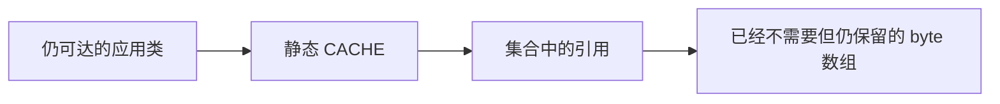

# 分配率高与保留泄漏：相似曲线，不同根因

**导航：** [学习路线](../README.md) · [故障顺序](README.md#学习顺序) · [第 11 章](../CURRICULUM.md#第-11-章oom栈溢出与内存预算)

实验默认按 [Minikube Pod 主流程](../PODS.md)执行；先创建学习环境，再构建单个镜像。日志跟随退出后，先导出证据再删除 fault Job。

本篇对应两个独立项目：[gc-churn](../../labs/gc-churn/README.md)与 [gc-retention](../../labs/gc-retention/README.md)。先复习 [根可达性](../foundations/04-reachability.md)和 [G1 周期](../gc/G1.md)。

## 1. 场景 A：根集合有界，分配却非常频繁

gc-churn 的 fault 在有界环中反复替换数组，默认只保留约 4 MiB payload；已被覆盖的旧数组没有持续保留路径。它可以累计分配很多 GiB，甚至在小堆和高压力下出现 Full GC，但集合不会按总分配量无界增长。

fixed 预先分配同样大小的缓冲池，并在循环中复用；两组工作窗口相同，但不保证操作数相同。这是“消除无效分配”的机制对照，不是吞吐基准或自动适用于所有业务的对象池方案。

```sh
minikube -p jvm-lab image build -t jvm-lab-gc-churn:local labs/gc-churn
kubectl --context jvm-lab -n jvm-labs apply -f labs/gc-churn/k8s/job-fault.yaml
kubectl --context jvm-lab -n jvm-labs logs -f job/gc-churn-fault -c lab --pod-running-timeout=120s
# 工作结束并导出 fault 证据后，再清理并运行 fixed
kubectl --context jvm-lab -n jvm-labs delete job gc-churn-fault
kubectl --context jvm-lab -n jvm-labs apply -f labs/gc-churn/k8s/job-fixed.yaml
kubectl --context jvm-lab -n jvm-labs logs -f job/gc-churn-fixed -c lab --pod-running-timeout=120s
```

| 参数 | 意义 | 默认 |
| --- | --- | --- |
| 第 1 项 | fault/fixed | fault |
| 第 2 项 | 工作秒数 | 5（脚本配置） |
| 第 3 项 | 环的 payload MiB | 4 |
| 第 4 项 | 单块 KiB | 4 |

脚本/Pod 使用 32 MiB G1 堆。程序单独直接运行的时长默认值可不同；实验以 result.json 的实际参数为准。

### 应先提出什么判断

若累计 allocatedPayloadMiB 持续增大，而根集合大小固定，候选是分配速率高、预算紧张、复制/晋升成本或并发工作赶不上，不能仅凭 GC 次数宣称泄漏。

`heapUsedKiB` 是采样瞬间占用，不是“完成一次完整回收后的存活集”。应从 GC 摘要的 before→after、重复回收后的基线和必要的对象图共同判断；一次高峰不足以证明持续保留。

### 看哪些证据

1. stdout：allocatedPayloadMiB、boundedSlots、工作窗口和 JVM 参数。
2. GC 日志：回收原因、频率、暂停、回收后占用是否形成持续上升趋势。
3. 分配样本：热点是否落在反复创建数组的路径，而非一开始猜收集器失效。
4. 根路径：固定环当前指向哪些数组，是否存在环之外的业务缓存或线程保留者。

```powershell
# 使用脚本打印的证据目录；正则只用于缩小范围，仍需按 GC ID 阅读
Select-String -Path build/faults/<运行目录>/jvm.log* -Pattern 'Pause Young|Pause Full|Concurrent Mark'
```

本机曾在 fault 的小堆高速分配下观察到多次 Full 和 allocation 疏散失败；这并不推翻“根集合有界”。需要区分“没有无界保留”与“负载一定健康”：短命对象照样可以让 CPU、GC 和延迟承压。

### 修复和回归

fixed 通过复用消除每轮分配。生产中的对策还可以是减少中间集合、避免重复编码/复制、批处理和入口背压；必须先确认对象不可变性、所有权和并发访问，不能为了省分配把同一可变缓冲区错误地跨请求共享。

对照时同时记录分配量、GC CPU/时间、业务吞吐和延迟。本实验没有请求指标；operations 变化只用于解释负载执行，不应直接变成生产性能承诺。

**E01：GC 很频繁，是不是泄漏？** 不是。先分清分配率和回收后存活集，再找根保留链；本例能反复分配超过堆上限，却只保留有界环。

**E02：频繁 Full GC 能不能直接证明泄漏？** 不能。堆预算、存活率、碎片、显式请求和工具行为等都可能影响；先读 cause，再找对象路径和增长趋势。

**E03：为什么不直接把所有对象池化？** 池会改变所有权、存活时间和并发协议，可能把短命对象变成长寿命保留。先验证分配热点和业务正确性，再衡量总成本。

## 2. 场景 B：静态集合保留无界数据

gc-retention 的 fault 把数组持续加入静态 CACHE。即使创建它们的循环进入下一轮，旧数组仍由缓存可达：



默认参数为 `fault 2048 64 1`：最多尝试 2048 块、每块 64 KiB、每步暂停 1 ms。在 32 MiB 堆中通常先于步数上限触发 OOM；具体块数依诊断预留、VM 和布局变化。

fixed 在加入新块前移除旧引用，使数组 payload 上限约为 8 MiB；它仍会分配和 GC，甚至在紧张的小堆中出现某些疏散压力，但不会无限增长 CACHE。

```sh
minikube -p jvm-lab image build -t jvm-lab-gc-retention:local labs/gc-retention
kubectl --context jvm-lab -n jvm-labs apply -f labs/gc-retention/k8s/job-fault.yaml
kubectl --context jvm-lab -n jvm-labs logs -f job/gc-retention-fault -c lab --pod-running-timeout=120s
# 工作结束并导出 fault 证据后，再清理并运行 fixed
kubectl --context jvm-lab -n jvm-labs delete job gc-retention-fault
kubectl --context jvm-lab -n jvm-labs apply -f labs/gc-retention/k8s/job-fixed.yaml
kubectl --context jvm-lab -n jvm-labs logs -f job/gc-retention-fixed -c lab --pod-running-timeout=120s
```

### 故障瞬间与诊断窗口

fault 会捕获预期 OOM，释放诊断预留后输出原始消息与保留块数。CACHE 本身仍保留，以便在观察窗口查根路径。自动 heap dump 若成功，是 catch 清理之前的证据。

捕获 OOM 后返回 0 只是教学程序为了导出证据的行为。必须检查 caught/message、GC 和 dump，不能把 Job Complete 或 status=completed 当作“没有发生故障”。

### 排障步骤

1. 确认消息是 Java heap space 等堆路径，不是 Metaspace 或容器终止。
2. 对齐持续增长的 retainedBlocks 与回收后的占用，解释为什么回收收益越来越低。
3. 在 heap dump 中找 byte[] 及保留大小，再沿 CACHE 的根路径定位保留者；只看数组数量排行榜不能说明谁负责清理。
4. fixed 改为容量约束后重放相同尝试步数，检查上限和根路径；若仍不足，继续检查容量是否符合业务而不是一味放大 Xmx。

### 两种“内存不够”不能混淆

若 8 MiB 是业务真正必须保留的数据，而可用堆连正常工作都容纳不了，是预算不足；若数据已过期却因静态集合不清理而增长，则是保留泄漏。加堆对后者通常只是延缓失败。堆 OOM 不必然说明泄漏，见 [JDK 25 OOM 分类](https://docs.oracle.com/en/java/javase/25/troubleshoot/troubleshooting-memory-leaks.html)。

**E04：给创建数组的局部变量设 null 能修复吗？** 不能切断 CACHE 的引用。必须找到真实保留链并修正容量、逐出或生命周期。

**E05：为什么 OOM 后的 heap dump 比最后一次普通监控曲线更有用？** 它提供当时对象和根路径的快照；但有采集成本，且不能代替时间趋势和业务含义分析。

**E06：把 Xmx 调大之后不再报错，能宣布修复吗？** 只能说明在该窗口暂时容纳了负载；还需验证存活集是否稳定、容量是否受控，以及长期增长和容器预算。

## 3. 共同误区：GC overhead 与 GC 时间

`GC overhead limit exceeded` 是特定实现/策略的错误条件，不是“GC 次数一多就必然抛出”的统一异常。不要把经典阈值口诀套给所有收集器；还要核对启用的收集器、选项与连续回收收益。[jdk-25-ga 自适应策略](https://github.com/openjdk/jdk/blob/jdk-25-ga/src/hotspot/share/gc/shared/adaptiveSizePolicy.cpp)

程序的 gcCount/gcTimeMs 来自 MXBean 累计口径。不同收集器的并发、代际和重叠工作不宜直接相加后解释成业务暂停总时长。要分析延迟，回到具体暂停、时间窗口、CPU 和请求链路。

---

[前置：第 11 章](../CURRICULUM.md#第-11-章oom栈溢出与内存预算) · [学习路线](../README.md) · [返回本章验收](../CURRICULUM.md#第-11-章oom栈溢出与内存预算) · [下一步：G1 退化](02-g1-pathologies.md)
