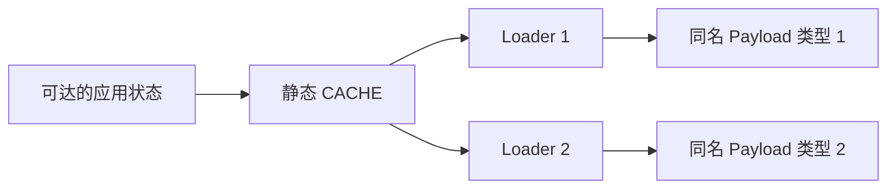

# 加载器保留：堆没有满，Metaspace 却耗尽

实验默认按 [Minikube Pod 主流程](../PODS.md)执行；先创建学习环境，再构建单个镜像。日志跟随退出后，先导出证据再删除 fault Job。

独立项目：[metaspace-leak](../../labs/metaspace-leak/README.md)。先复习 [类身份与卸载](../foundations/03-class-loading.md)。这里观察类元数据预算与加载器生命周期，不把它误称为普通 byte[] 堆泄漏。

## 1. 同一份字节可以产生很多运行时类型

程序从本项目 JAR 读取 Payload 的 class 字节。每轮创建新的 IsolatedLoader，用它定义同名 Payload，再把加载器加入静态 CACHE。



只比二进制名称或 class 文件哈希，不能判断类型相同。定义加载器不同，类型身份也不同。由于 CACHE 保留这些加载器，相关类型资源不能按“业务早就不用了”自行消失。

类卸载受定义加载器是否可回收等约束；它是一项实现可以进行的优化，不能保证某次 GC 后立刻发生。[JLS 25 §12.7](https://docs.oracle.com/javase/specs/jls/se25/html/jls-12.html#jls-12.7)、[ClassLoader 25](https://docs.oracle.com/en/java/javase/25/docs/api/java.base/java/lang/ClassLoader.html)

## 2. 故障与修复

```sh
minikube -p jvm-lab image build -t jvm-lab-metaspace-leak:local labs/metaspace-leak
kubectl --context jvm-lab -n jvm-labs apply -f labs/metaspace-leak/k8s/job-fault.yaml
kubectl --context jvm-lab -n jvm-labs logs -f job/metaspace-leak-fault -c lab --pod-running-timeout=120s
# 工作结束并导出 fault 证据后，再清理并运行 fixed
kubectl --context jvm-lab -n jvm-labs delete job metaspace-leak-fault
kubectl --context jvm-lab -n jvm-labs apply -f labs/metaspace-leak/k8s/job-fixed.yaml
kubectl --context jvm-lab -n jvm-labs logs -f job/metaspace-leak-fixed -c lab --pod-running-timeout=120s
```

配置为 64 MiB 最大堆、16 MiB MaxMetaspaceSize，默认最多定义 12000 次。fault 不清理 CACHE；fixed 在缓存达到 64 个加载器后清掉旧批次。fixed 循环不主动调用 System.gc，由实际元空间压力和 VM 策略处理可卸载资源。

输出包括 defined、cachedLoaders、loaded、unloaded。加载数量统计包含 VM 和框架其他类，不能期待它与自定义 defined 严格相等。

## 3. 证据链

1. 确认 OOM 的原始消息是 Metaspace，而不是 Java heap space。
2. 核对该进程 MaxMetaspaceSize、加载趋势和卸载情况；不要只看堆 used。
3. 用 class-loader 统计和 NMT 观察类元数据相关类别；用 heap dump 找 CACHE→加载器的保留路径。
4. fixed 在较小缓存下完成同样的定义次数，检查卸载量和使用是否趋稳。未在某个瞬间卸载不等于无法卸载。

```powershell
# 用实际 PID；可用命令先查 help
jcmd $labPid VM.classloader_stats
jcmd $labPid VM.native_memory summary
jcmd $labPid GC.heap_info
```

heap dump 展示 Java 堆中的加载器、Class 镜像和根关系，不是把所有本地 Metaspace 字节都直接转成堆对象。结合两类证据，才能解释保留者与消耗的资源。

## 4. 故障之后的图为什么不同

为避免元空间耗尽后连诊断类都无法加载，fault catch 会清空加载器缓存并请求一次 GC，然后报告原始 OOM。日志明确输出 `clear-loader-cache-for-diagnostics`。自动 OOM heap dump 若成功，记录的是这次清理之前的根关系。

因此不能在 hold 时看到 cachedLoaders=0 或大量 unloaded，就宣称故障前没有保留。这个清理动作是取证设施，不证明真实服务器在任意 Metaspace OOM 后均可恢复。

## 5. Full GC 不必为零

最终 fixed 本机完成 12000 次定义、缓存尾部为 32 个加载器，并观察到类卸载。它仍有元数据压力相关的 Full GC；这不等于原泄漏没修复。应分清“用完空间后能否回收过期加载器”与“完全不发生 GC”。

fault 中还有为诊断而显式请求的 GC。统计 Full 时要看 cause，并把该清理请求与压力触发分开。具体次数、卸载量见 [RESULTS](RESULTS.md)。

## 6. 迁移到真实热部署问题

真实保留链可能来自存活线程的 TCCL、线程池任务、ThreadLocal、父加载器侧缓存、注册表或回调，而不只是本例的静态 List。停止业务实例不代表这些外部关系自动解除。

修复应对准生命周期：停止线程、取消注册、清理上下文和缓存、释放旧加载器拥有的资源；再多轮部署验证。仅增大 MaxMetaspaceSize 可以延缓失败，不能替代根因处理。

**E16：为什么堆还有空闲也会 OOM？** 本例受类元数据预算约束；先分流错误类型，再看 Metaspace 和加载器，不能直接加 Xmx。

**E17：不再 new 旧类实例，类就能卸载吗？** 还要检查定义加载器及相关保留路径；没有业务实例只是一个线索，不足以证明满足卸载条件。

**E18：fixed 仍然 Full，怎样证明有所改善？** 对齐同样的定义次数，检查是否仍耗尽、缓存是否有界、类能否卸载和元空间是否趋稳；不能把 GC 零次当唯一成功标准。
