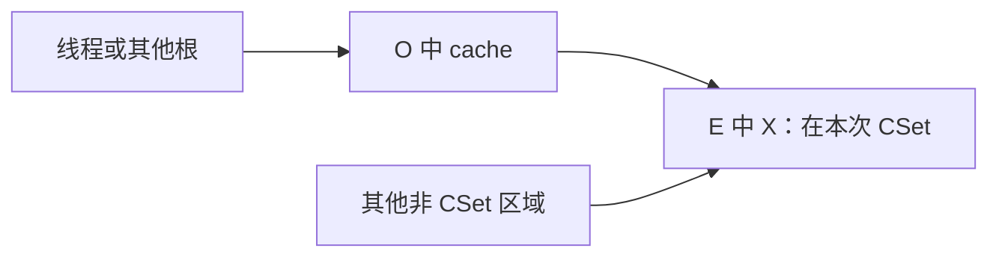
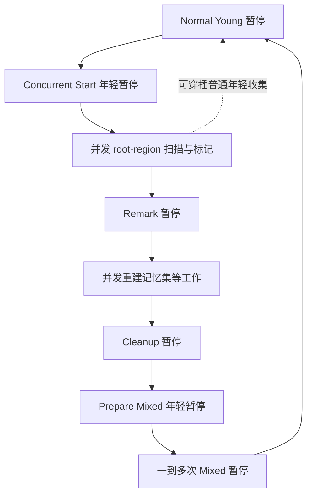

# G1：区域选择、并发标记与停顿内疏散

**导航：** [学习路线](../README.md) · [专题顺序](README.md#阅读顺序) · [第 07 章](../CURRICULUM.md#第-07-章g1分代-zgc-与选择依据)

前置：[F05 GC 基础](../foundations/05-gc.md)。本篇固定 HotSpot `jdk-25-ga`；阅读后运行 [专题实验](EXPERIMENTS.md)。G1 的目标是平衡吞吐和停顿，并用历史信息预测可在目标时间内完成多少工作；暂停目标不是实时保证。

## 1. 先建立两条相互配合的主线

**疏散主线**在 STW 中处理选中的区域：找到存活对象，把它们复制到目的地，修正引用，回收可以释放的源区域。

**并发标记主线**与应用交错，获得老年代对象的存活信息和后续候选区域。它为回收决策提供信息，但不会在一次普通标记遍历中顺便搬走所有老对象。

因此问“一次 G1 GC 做什么”，要先问是在说年轻疏散暂停、整个并发标记周期、mixed 暂停还是 Full GC。[官方概览](https://docs.oracle.com/en/java/javase/25/gctuning/garbage-first-g1-garbage-collector1.html)

## 2. Region 是角色可变的内存管理单位

一个 region 内地址连续，多个年轻或老 region 不要求连在一起。空闲 region 可以在后续分配中承担不同角色：

```text
示意：每格一个等大 region，不代表实际地址布局
[Eden][Old ][Free][Surv][Old ][Free][H-start][H-cont]
```

Eden 接收普通年轻分配；Survivor 保存某些年轻幸存对象；Old 保存老对象；humongous 用起始及连续后继 region 承载大对象。TLAB 从适用的堆区域中分配，不是堆外的一块“线程专用内存”。

| 结构 | 保存或描述什么 | 不能拿它替代什么 |
| --- | --- | --- |
| Region 元信息 | 区域角色、使用范围等 | 某次标记中每个对象的存活位 |
| 标记位图与标记队列 | 对象标记状态、待遍历工作 | 跨区域引用字段的完整目录 |
| Card table | 哪些来源堆小块需要关注 | 对象是否存活的标记位图 |
| Remembered set/card set | 收集范围外可能指入该范围的位置摘要 | 仅记录目标对象的集合 |
| Collection Set，CSet | 本次暂停选中的源 region/组 | 本轮所有并发标记到的存活对象 |
| PLAB | GC 工作线程分配复制目的空间的缓冲 | 应用线程的 TLAB |

记忆集按卡等粒度压缩来源位置，会有需要过滤的候选。`jdk-25-ga` 的 CSet 候选还涉及区域组共享 card set，不应假定每个 region 永远独享一个完全独立的集合。[CSet 实现](https://github.com/openjdk/jdk/blob/jdk-25-ga/src/hotspot/share/gc/g1/g1CollectionSet.cpp)

## 3. 为什么需要外部到 CSet 的引用

假设本次收集 Eden 区域 E，而老区域 O 的 `cache.ref` 指向 E 中对象 X。根只直接指向 cache；如果既不遍历全部老年代，也没有跨区域记录，X 可能被漏掉。



G1 必须找出这样的入边。一方面从线程、VM、代码等根开始，另一方面合并和扫描记忆集所描述的来源位置。注意记录的是 `cache.ref` 所在的来源卡：X 移动时，需要改的是引用槽里的值。

这个问题超出 old→young；mixed 也会收老 region，所以应理解成“CSet 外 → CSet 内”。在 CSet 内追踪对象时还要继续处理其引用，不能只复制直接根指向的一层。

## 4. 一次字段写入涉及两种不同的屏障职责

考虑 `owner.ref = replacement`。在并发标记开启的条件下，旧引用和这次写入的来源位置服务于不同目标：

| 动作 | 关注谁 | 解决什么问题 |
| --- | --- | --- |
| SATB 前置屏障 | 被覆盖的旧引用值 | 避免破坏标记开始时需要追踪的存活关系 |
| 后置写屏障与脏卡处理 | 被写字段所在的来源卡 | 让以后能找到跨区域入边并修正引用 |

用于推理的伪代码如下，不是完整可替换的 HotSpot 屏障代码；真实实现还有初始化、引用强度、空值、装饰器和编译器优化等条件。

```text
old = owner.ref
若需维护 SATB：记录 old
owner.ref = replacement
若需维护跨区信息：标记/提交 owner.ref 所在来源卡
```

不要把 SATB 队列叫作记忆集，也不要说它只负责记录新对象。前置屏障的代表入口是 `write_ref_field_pre`/`enqueue`，后置处理可从 `write_ref_field_post` 继续跟踪。[G1BarrierSet.inline.hpp](https://github.com/openjdk/jdk/blob/jdk-25-ga/src/hotspot/share/gc/g1/g1BarrierSet.inline.hpp)

## 5. SATB 的漏标风险与保守保留

用一个简化场景理解删除旧边的风险：标记开始时 Root→A→B；A 尚未被完整扫描，应用覆盖了 A.ref。若没有额外记录，后面再扫描 A 时已经看不到旧的 B。

SATB 把被覆盖的旧引用纳入本轮标记工作，从而保留标记开始时的关系。这里不要求复制整张对象图；记录旧引用加上标记遍历，才构成这项保守策略。

本轮开始之后，B 即使已经变为无用，也可能由于该记录继续保留到以后回收。这叫浮动垃圾，不表示实现把仍存活对象误当垃圾。新分配对象又有相应的“本轮隐式存活”等处理，不能照着开头的一张快照图对所有后续对象作简单删除。

学习源码时要把标记位图与 TAMS（标记开始时的分配边界）一起看：它们用于区分哪些对象需要通过本轮标记位解释、哪些属于后续分配范围。TAMS 不是“region 永远不再变化的顶指针”。[并发标记实现](https://github.com/openjdk/jdk/blob/jdk-25-ga/src/hotspot/share/gc/g1/g1ConcurrentMark.cpp)

## 6. JDK 25 的脏卡与 refinement 路径

后置屏障将需要关注的来源卡标脏，相关卡通过脏卡队列等机制交给并发 refinement。refinement 扫描来源卡中的引用，更新目标侧需要的 remembered/card-set 信息，减少暂停时才处理的积压。

应用可能在 refinement 扫描和清卡附近再次改写引用，所以卡状态、内存序和队列协调关系属于正确性内容，不能随意删掉某条屏障。`jdk-25-ga` 的慢路径仍能看到 `OrderAccess::storeload`、`G1DirtyCardQueue` 和 enqueue。[G1BarrierSet.cpp](https://github.com/openjdk/jdk/blob/jdk-25-ga/src/hotspot/share/gc/g1/g1BarrierSet.cpp)、[G1ConcurrentRefine](https://github.com/openjdk/jdk/blob/jdk-25-ga/src/hotspot/share/gc/g1/g1ConcurrentRefine.cpp)

如果并发处理赶不上引用修改速度，暂停的堆根合并/扫描等工作可能增加。要看来源卡数量、引用密度、工作分布和 CPU，不能只说“堆大，所以 GC 慢”。

**版本边界：** JEP 522 的双卡表改进交付在 JDK 26。它不是本篇的 JDK 25 路径，也不是这里的 SATB 双缓冲概念。不要把后来简化的写屏障机器码或同步结论套回 25。[JEP 522](https://openjdk.org/jeps/522)

## 7. 一次年轻疏散暂停怎样完成

下表是工作依赖的学习拆解，阶段可以由多个 GC 工作线程并行推进，并非每项都是一个独立串行线程。

| 工作 | 主要输入 | 输出/需要维持的不变量 |
| --- | --- | --- |
| 准备 CSet 与工作线程 | 当前年轻区域、策略预测、候选 | 确定源区域与本次工作预算 |
| 合并外部堆根信息 | 记忆集、待处理卡等 | 可扫描的外部入边位置 |
| 扫描根并发现对象 | 线程/VM/代码根与堆根 | 找到 CSet 中待保留对象 |
| 复制或晋升 | 对象大小、年龄、目的空间 | 为存活对象取得合法目的位置 |
| 建立转发、处理竞争 | 旧对象与新副本 | 多线程发现同一对象时取得一致目的地 |
| 修正引用并继续追踪 | 引用槽、复制对象的字段 | 后续读取能够访问正确对象 |
| 引用处理与清理 | 发现的特殊引用、回收统计 | 完成保留语义、释放可回收源区域 |

GC 工作线程可用 PLAB 降低目标空间分配竞争。多个线程可能同时尝试复制 X；转发信息和原子发布使引用最终指向同一个有效副本，输掉竞争的一侧处理多余分配。不要以为“STW”就表示 GC 内部没有并发竞争。

`G1ParScanThreadState::do_copy_to_survivor_space`、`forward_to_atomic` 和对象字段扫描可连接这条主线。[对象复制实现](https://github.com/openjdk/jdk/blob/jdk-25-ga/src/hotspot/share/gc/g1/g1ParScanThreadState.cpp)

与 ZGC 的关键区别是：G1 的常规年轻/mixed 对象疏散在应用暂停时完成；应用恢复前，要使相关引用满足恢复执行的要求。不能给 G1 套上“普通应用每次读对象时靠 ZGC 式搬迁屏障修复”的描述。特殊引用等访问仍有自己的处理，别扩大成 G1 完全没有任何读侧屏障代码。

## 8. 完整周期：从 young-only 到 mixed，再回到 young-only



该图表达典型依赖，不保证每次启动标记都走完全套：可能出现 Concurrent Mark Undo、周期被中止或没有值得做 mixed 的候选。应以日志中的实际事件确认。

| 阶段 | 是否暂停应用 | 核心含义 |
| --- | --- | --- |
| Normal Young | 是 | 回收年轻 CSet，部分对象晋升 |
| Concurrent Start | 是 | 年轻收集同时建立并发标记所需起点 |
| Root Region Scan/Concurrent Mark | 主要并发 | 追踪标记、处理根区域及 SATB 等工作 |
| Remark | 是 | 协调并完成标记收尾等工作 |
| Rebuild Remembered Sets 等 | 并发工作 | 为候选回收准备相应信息 |
| Cleanup | 是 | 根据标记结果整理区域和候选等状态 |
| Prepare Mixed | 是 | 为进入空间回收阶段作过渡 |
| Mixed | 是 | 年轻区域加选中的老区域共同疏散 |

年轻收集与并发标记需要配合 root-region 扫描；新一轮暂停不能无视尚未完成的相关扫描。源码不是“一个后台标记线程随便扫，前台想收就收”。[周期协调](https://github.com/openjdk/jdk/blob/jdk-25-ga/src/hotspot/share/gc/g1/g1ConcurrentMarkThread.cpp)

## 9. CSet 为什么不是简单选择垃圾最多的 region

一个区域的回收价值要结合能释放的空间、存活对象复制量、入边扫描和其他成本。垃圾多但跨区引用非常密集的候选，未必能在本次预算中带来最合适收益。

教学算例：候选 A 可释放 6 MiB、预计扫描加复制 3 ms；B 可释放 8 MiB、预计 10 ms。如果本轮只剩 4 ms，B 释放空间更多也不代表可直接选择。真实模型还要满足年轻工作、最小/最大老区域选择和可选组等约束；这个比值不是源码的完整公式。

暂停目标调小可能使每轮处理更少、回收更频繁，增加固定开销和 CPU 需求；调大可能提高吞吐但增加暂停。`MaxGCPauseMillis=100` 不是“所有暂停和请求都小于 100 ms”。[G1Policy](https://github.com/openjdk/jdk/blob/jdk-25-ga/src/hotspot/share/gc/g1/g1Policy.cpp)、[CSet 选择](https://github.com/openjdk/jdk/blob/jdk-25-ga/src/hotspot/share/gc/g1/g1CollectionSet.cpp)

## 10. IHOP 怎样给并发标记留时间

G1 不应等到老年代彻底用完才开始并发标记，因为标记期间应用还会继续晋升和分配。adaptive IHOP 使用历史标记时长、老年代分配速率和可用目标空间等信息决定起点。

用简化预算推理：若预计完成有关并发工作需要 4 秒，而期间每秒新增 10 MiB 老年代占用，启动时至少要考虑约 40 MiB 后续增长，再加年轻疏散和安全余量。这个算例说明为什么“还有空闲就不用 GC”不成立，不是精确阈值算法。

`InitiatingHeapOccupancyPercent`、`G1UseAdaptiveIHOP` 和 `G1ReservePercent` 要组合解释。reserve 是策略中的空闲缓冲目标，不等于单独隔离一块只允许 GC 使用的地址。突增的分配或 CPU 限制可能使基于历史的预测失效。[IHOP 实现](https://github.com/openjdk/jdk/blob/jdk-25-ga/src/hotspot/share/gc/g1/g1IHOPControl.cpp)

生产调优先确认 GC 开始是否过晚、标记是否过慢、增长是否来自正常存活集还是泄漏，再决定是否调整阈值/预算，不能把固定低 IHOP 作为通用配方。

## 11. Humongous 与碎片

`jdk-25-ga` 以对象总大小严格大于半 region 阈值判断 humongous。对象头、数组长度信息及对齐都包含在总大小中；payload 等于半 region 不代表对象总大小也恰好等于边界。[精确判断入口](https://github.com/openjdk/jdk/blob/jdk-25-ga/src/hotspot/share/gc/g1/g1CollectedHeap.hpp)

例如强制 1 MiB region 后，一个 payload 为 1 MiB 的 byte 数组，加上头和对齐就略大于一整个 region，需要连续的两个 region。最后一个 region 的尾部不能任意拿给普通对象填满，因此可能出现看似“数组才这么大”却占用更多 region 的现象。

大对象分配需要连续 region，总空闲多不等于有足够连续空间。部分原始类型数组存在 eager reclaim 等特殊处理，不能说所有 humongous 对象都必须等 Full GC；它们也不是每次年轻疏散都像普通小对象一样移动。

## 12. 疏散失败、pinning 与 Full GC

| 现象 | 需要分别调查的原因 | 不能直接推出的结论 |
| --- | --- | --- |
| 目的空间分配不足 | 存活率、晋升量、空闲余量和回收是否及时 | “只要堆里还有空闲就一定能复制” |
| pinned region 无法正常移动 | 本地访问等 pinning 条件与保留区域 | “发生 evacuation failure 就一定是 Java OOM” |
| Full GC | 正常路径不能及时满足需要，或显式/工具触发等 | “所有 Full 都是内存泄漏” |

失败时可能使用自转发、保留有关区域并安排后续处理；不能部分复制完就直接把整个源 region 清空。G1YoungCollector 区分 allocation 与 pinned 等失败状态。[失败处理与统计](https://github.com/openjdk/jdk/blob/jdk-25-ga/src/hotspot/share/gc/g1/g1YoungCollector.cpp)

Full GC 有自己的全堆处理和整理路径，不能把它描述成“再来一次普通 mixed”。排查时对齐前面的并发周期、失败原因、GC cause、humongous 和剩余空间。[G1FullCollector](https://github.com/openjdk/jdk/blob/jdk-25-ga/src/hotspot/share/gc/g1/g1FullCollector.cpp)

## 13. 源码按三条链读

| 主线 | 已核对的入口与下一步 | 要画出的状态变化 |
| --- | --- | --- |
| 一次疏散暂停 | `G1CollectedHeap::do_collection_pause_at_safepoint_helper` → `G1YoungCollector::collect` → pre/evacuate/post | CSet、外部根、对象副本、转发与源区域 |
| 并发标记 | `G1ConcurrentMarkThread::concurrent_mark_cycle_do` → root-region/mark loop/remark/rebuild/cleanup | 位图、SATB、候选区域 |
| 字段写入 | `write_ref_field_pre` 与 `write_ref_field_post` → 脏卡/队列/refinement | 旧值和来源卡分别去哪 |

上表是阅读导航，省略了 VM operation、worker 调度、编译器生成的快路径等中间层，不是逐层无遗漏的 C++ 调用栈。堆暂停入口见 [G1CollectedHeap.cpp](https://github.com/openjdk/jdk/blob/jdk-25-ga/src/hotspot/share/gc/g1/g1CollectedHeap.cpp)。

源码阅读作业：只选一个字段赋值，把 SATB 记录的值与后置记录的位置写成两列；再跟踪一次对象复制中的转发竞争。读完应能解释“为什么保留对象”和“为什么找到要修正的引用”是两个问题。

## 14. 把机制连接到日志与面试

| 日志线索 | 机制解释方向 | 下一项证据 |
| --- | --- | --- |
| Merge/Scan Heap Roots 占比高 | 跨区入边、来源卡、引用密度或积压 | phases/remset、负载引用写入和工作线程分布 |
| Object Copy 占比高 | 存活复制量、晋升、内存带宽与目的空间 | 年轻存活、old 增长、PLAB/evacuation 信息 |
| Concurrent Mark 很慢 | CPU 竞争、存活图、线程配置和预算 | 容器配额、GC CPU、实际并发时长 |
| Humongous regions 高 | 大数组或其他大对象的分配/保留 | 对象大小、region 大小、分配样本 |
| Pause Full 前出现失败 | 回收赶不上、目的空间不足等 | 前序周期与 failure/cause |

日志字段名称依构建和日志级别核对；实测步骤见 [实验手册](EXPERIMENTS.md)。先能用实际日志解释本篇周期，再完成 [专题追问](INTERVIEW.md)。

---

[前置：GC 基础](../foundations/05-gc.md) · [学习路线](../README.md) · [下一步：G1 周期实验](EXPERIMENTS.md#2-g1观察完整周期)
