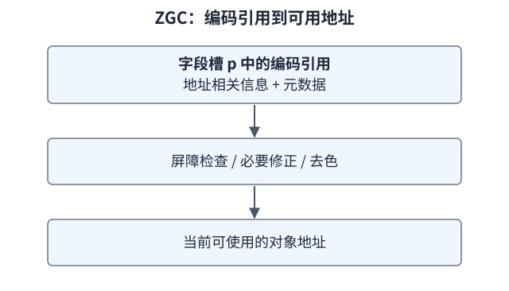
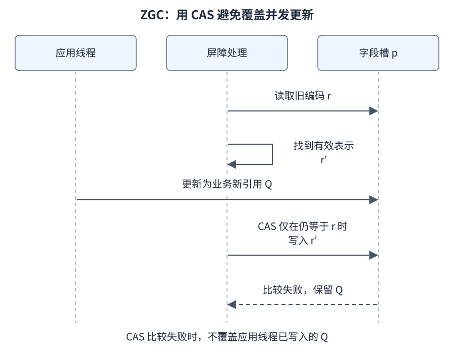
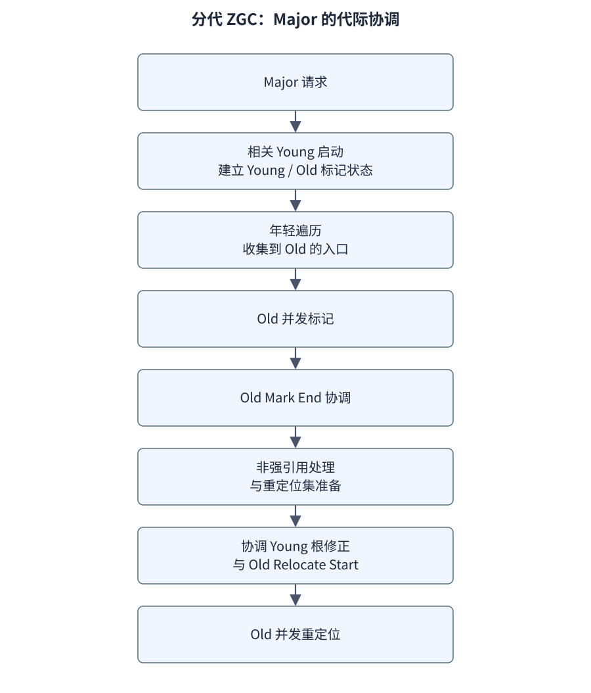

# 分代 ZGC：颜色、屏障与并发重定位

**导航：** [学习路线](../README.md) · [专题顺序](README.md#阅读顺序) · [第 07 章](../CURRICULUM.md#第-07-章g1分代-zgc-与选择依据)

前置：[F05](../foundations/05-gc.md)和 [G1](G1.md)。本篇固定 HotSpot `jdk-25-ga`，不是早期非分代 ZGC 的重新命名。JEP 439 用于理解设计，具体周期、颜色表示和调用链核对 25 源码；25 已继承非分代模式移除的变化。[JEP 439](https://openjdk.org/jeps/439)、[JEP 490](https://openjdk.org/jeps/490)

## 1. ZGC 要把哪些工作移出长暂停

G1 的常规对象疏散在应用暂停中完成；ZGC 将大量标记和对象重定位工作放到与应用交错的阶段。因此难题不仅是找到存活对象，还包括：应用拿着旧引用时，如何定位已经移动的对象；应用修改引用时，如何保持标记和跨代跟踪正确。

它仍有短暂停和协调动作，也会花费并发 CPU、内存带宽和元数据空间。若应用分配速度超过可提供空间的速度，应用可以发生分配等待。低 STW 不等于没有应用延迟。

## 2. 堆组织：代、页、年龄和重定位集合

| 概念 | 在实现中的用途 | 别套用的旧模型 |
| --- | --- | --- |
| Young/Old generation | 分开安排不同代的回收工作 | 固定 8:1:1 Eden/S0/S1 |
| ZPage | 对象分配、存活统计、年龄与重定位等管理 | 等同操作系统的一张 4 KiB 物理页 |
| 页内活跃信息 | 找出要保留的对象并统计存活 | 所有对象的颜色就是对象头中的一个全局存活位 |
| Relocation set | 选中需要重定位处理的来源页 | 每次全堆所有页都搬一遍 |
| Forwarding | 把旧对象位置关联到有效新位置 | 应用必须等全堆所有引用都改完才能运行 |
| Remembered set | 年轻收集需要的老→年轻字段位置 | G1 来源卡粒度的 RSet 原样复用 |

ZGC 有不同页类型和不同对象大小的处理路径。页年龄、晋升阈值和 relocation 选择由策略与统计配合，不是让每个对象经过固定 15 次传统 Survivor 复制。[ZGeneration](https://github.com/openjdk/jdk/blob/jdk-25-ga/src/hotspot/share/gc/z/zGeneration.cpp)、[重定位选择器](https://github.com/openjdk/jdk/blob/jdk-25-ga/src/hotspot/share/gc/z/zRelocationSetSelector.cpp)

## 3. 着色指针描述的是引用表示与当前阶段的关系

堆中对象引用字段用带元数据的表示编码，供应用正常解引用的值需要由屏障转换为合适的地址表示。学习时区分：字段的位置 p、字段保存的编码引用、去色后的目标地址、目标对象本身。

[](https://raw.githubusercontent.com/chuanhui2020/jvm-deep-dive/main/docs/assets/diagrams/zgc-reference-decoding.svg)

[打开大图](https://raw.githubusercontent.com/chuanhui2020/jvm-deep-dive/main/docs/assets/diagrams/zgc-reference-decoding.svg)

`jdk-25-ga` 的 zAddress 定义涉及年轻标记、老标记、finalizable、remembered、remapped 等元数据。不同架构的编码和指令优化可能不同；不要背早期 ZGC 的“固定地址位数 + 固定几个高位颜色”的图来回答 25。[zAddress.hpp](https://github.com/openjdk/jdk/blob/jdk-25-ga/src/hotspot/share/gc/z/zAddress.hpp)

| 学习用状态 | 它回答的问题 | 不表示什么 |
| --- | --- | --- |
| load-good | 这个编码引用是否满足当前普通读取的条件 | 这个对象在所有未来周期永远不用处理 |
| mark-good | 是否满足相应标记/保持存活处理要求 | 每个指向同一对象的引用都立刻有完全相同元数据 |
| store-good | 写屏障所需的阶段工作是否已满足 | Java 层发生了 volatile 写或建立了 happens-before |

good/bad 相对于当前代的阶段掩码解释。阶段转换可以改变“什么颜色算 good”，使旧字段在下一次访问时进入相应处理。元数据会按周期翻转，不是无限累加的业务对象版本号。

对象字段和栈/寄存器供应用使用的引用表示也不能混为一谈；屏障本身当然需要在机器指令中操作编码值。根、栈和编译代码有各自的协调机制，不是给每个 Java 变量都附加一个能从 Java 反射读取的颜色字段。

## 4. 普通读屏障：拿到的是当前有效对象

用 `Object x = owner.ref` 推演：

1. 从字段槽 p 读取编码引用 r。
2. 快路径检查是否满足当前 load-good/null 等条件；满足则以正确的去色地址继续。
3. 若需要修正，结合代和转发信息解析旧位置；必要时参与/等待相关重定位处理。
4. 返回有效地址，并在适用时尝试把字段槽更新为更好的表示。

这些步骤不是每次读取都完整执行。快路径的目的就是让大多数已满足条件的访问少付成本。相反，也不能把 bad 理解成“非法 Java 引用、对象已经被回收”。它通常表示需要经过当前 GC 协议修正。

普通强引用读取与弱/虚引用、保持存活等屏障入口有区别。分代 ZGC 不应再简单概括为“普通读屏障负责一切标记”：相当一部分标记维护职责已由写屏障承担，专门的标记屏障与特殊引用路径仍存在。[ZBarrier::load_barrier_on_oop_field_preloaded](https://github.com/openjdk/jdk/blob/jdk-25-ga/src/hotspot/share/gc/z/zBarrier.inline.hpp)

## 5. 自修复为何不能直接覆盖字段

假设 GC 解析到旧引用 r 应该对应新地址 r'，但它准备修复字段时，应用已把 owner.ref 改成另一个对象 Q。若直接把 r' 写回去，就会覆盖业务更新。

源码的 `ZBarrier::self_heal` 使用原子比较交换等约束：仅在字段仍是预期旧值时修正，失败后重新检查是否已经满足条件；还需要保持元数据转换的单调性和特殊引用约束。[自修复实现](https://github.com/openjdk/jdk/blob/jdk-25-ga/src/hotspot/share/gc/z/zBarrier.inline.hpp)

[](https://raw.githubusercontent.com/chuanhui2020/jvm-deep-dive/main/docs/assets/diagrams/zgc-cas-self-healing.svg)

[打开大图](https://raw.githubusercontent.com/chuanhui2020/jvm-deep-dive/main/docs/assets/diagrams/zgc-cas-self-healing.svg)

这是解释为什么需要 CAS 的并发情形；真实屏障代码还要处理颜色升级、空引用和阶段关系，不是只实现这张图就完成 ZGC。

## 6. 写屏障同时维护两种不同信息

对 `owner.ref = newValue`，写屏障不能只看 newValue。它要利用**将被覆盖的旧编码引用**以及**字段位置 p**完成适用的工作：

| 数据 | 主要用途 |
| --- | --- |
| 旧值 prev | 在相应标记阶段维护 SATB，避免丢失旧边 |
| 字段地址 p | 在老页上记录可能的跨代引用位置 |
| 当前阶段的颜色 | 判断本轮相关工作是否已经满足，控制快慢路径 |

学习伪代码如下，仅表示职责；省略空值、native/special reference、初始化、缓冲与编译器生成快路径等分支。

```text
prev = 字段 p 中的旧编码引用
若 prev 不满足本轮 store-good 条件：
    处理或缓冲 (p, prev)
    对需要维护的旧目标执行标记相关工作
    若 p 属于老代，记录 p 以供年轻收集识别跨代入口
以满足当前规则的表示把 newValue 存入 p
```

`heap_store_slow_path` 可能把 `(p, prev)` 放入 store barrier buffer；直接处理路径中可看到 `mark_and_remember`。后者把旧目标的标记工作与 p 的记忆集登记分开执行。[ZBarrier.cpp](https://github.com/openjdk/jdk/blob/jdk-25-ga/src/hotspot/share/gc/z/zBarrier.cpp)、[Store barrier buffer](https://github.com/openjdk/jdk/blob/jdk-25-ga/src/hotspot/share/gc/z/zStoreBarrierBuffer.cpp)

buffer 不是允许无期限拖延正确性工作的普通队列；阶段切换、冲刷以及 p 所在对象移动时，需要一起处理这些记录。写屏障成本也不能只按进入 C++ 慢路径的次数计算，JIT 快/中间路径、缓冲和实际引用修改模式都有影响。

## 7. SATB 与 act-once：为什么不需要每次做同样的慢路径

同一个字段在一个有关 epoch 内反复被写，首次处理可为对应的标记与 remembered 维护建立必要信息；颜色快速检查可让后续写入避免重复做相同工作。这里的 act-once 是相关阶段和字段位置上的协议，**不是“每个业务对象终生只执行一次屏障”**。

以 p 初始指向 X，随后写成 Y，再写成 Z 为例：第一次需要处理 X 及记录 p；对 Y/Z 的正确性还依赖它们的来源、新分配对象规则及本轮其他扫描，不是随意丢弃后续引用变化。周期改变颜色后，p 会在新阶段重新满足相应记录要求。

进一步区分：同一字段重复写和大量不同字段各写一次，产生的屏障/记忆集压力可能不同。只按总写入次数比较两个负载，会漏掉“唯一被修改字段数”这个维度。

JEP 439 的 act-once、融合检查和缓冲设计用于理解动机；真实 25 路径应跟踪 `is_store_good_fast_path`、`store_barrier_on_heap_oop_field` 与阶段翻转。[屏障实现](https://github.com/openjdk/jdk/blob/jdk-25-ga/src/hotspot/share/gc/z/zBarrier.inline.hpp)

## 8. 精确到字段位置的双缓冲记忆集

年轻收集需要发现老代对象中指向年轻代的引用。ZGC 在老页中维护潜在字段位置对应的位图，不用把整个来源卡中的所有字段当成同一个最小记录单位。

`ZRememberedSet` 包含 current 与 previous 两份位图：应用新增登记进入当前活动集合；GC 用相应的前一集合寻找跨代入口。切换后，扫描仍指向年轻对象的位置可重新登记；已变成 null/老目标等的条目可以被过滤。[ZRememberedSet](https://github.com/openjdk/jdk/blob/jdk-25-ga/src/hotspot/share/gc/z/zRememberedSet.hpp)、[扫描与过滤](https://github.com/openjdk/jdk/blob/jdk-25-ga/src/hotspot/share/gc/z/zRemembered.cpp)

```text
阶段切换前：应用登记到 current A，GC 使用对应 previous B
切换后：两份集合的角色按协议翻转
扫描某个 p：读取当前有效目标 → 仍指向 Young 则保留必要登记
```

不能把这张简图理解为“不用任何同步随便交换两个数组”。字段被并发修改、p 所在页重定位、老页死亡和晋升等情况都需要专门协调。buffer 中的字段位置也要随对象搬迁修正。

**它与 JEP 522 的 G1 双卡表不是同一个结构。** 前者是分代 ZGC 的跨代字段位图机制；后者是另一收集器在 JDK 26 的实现改进。

## 9. 年轻代收集的实际阶段

`ZGenerationYoung::collect` 给出清晰的阅读顺序。下表把常规路径的阶段与产物连接起来；条件验证、失败重试或中止会影响实际日志。

| 阶段 | 应用状态 | 关键工作/产物 |
| --- | --- | --- |
| Pause Mark Start | STW | 切换有关颜色、开始标记状态、切换记忆集等 |
| Concurrent Mark | 并发 | 处理根、扫描跨代入口、追踪年轻对象图 |
| Pause Mark End | STW | 尝试确认标记结束；若未结束则继续并发标记后重试 |
| Concurrent Mark Free | 并发 | 释放相关标记工作资源 |
| Concurrent Reset Relocation Set | 并发 | 清理上次相应重定位集合状态 |
| Concurrent Select Relocation Set | 并发 | 结合存活统计、年龄与空间策略选择来源页 |
| Pause Relocate Start | STW | 切换重定位有关颜色与状态 |
| Concurrent Relocate | 并发 | 搬迁/晋升、转发及根相关修正 |

根扫描并非都塞进 Pause Mark Start；源码中的 mark_roots 在并发标记路径执行。暂停负责必要的状态协调，线程根、代码根等还涉及各自协议，不能说“ZGC 启动暂停中扫描全部线程栈和全堆”。[年轻代路径](https://github.com/openjdk/jdk/blob/jdk-25-ga/src/hotspot/share/gc/z/zGeneration.cpp)

## 10. Major 收集怎样连接年轻代和老年代

JDK 25 的 `ZDriverMajor::gc` 主线先 `collect_young` 再 `collect_old`。但不能把它画成两套完全独立的 GC：有关 major 的年轻代启动路径会同时启动 young/old 标记状态；年轻对象的遍历还负责收集指向老代的根信息。

对于不同 cause，年轻前置处理可能采用 full-preclean、full-roots 或 partial-roots 等类型。这里的 “full” 是内部策略语境，不能直接翻译成 G1 的 STW Full GC。

[](https://raw.githubusercontent.com/chuanhui2020/jvm-deep-dive/main/docs/assets/diagrams/zgc-major-cycle.svg)

[打开大图](https://raw.githubusercontent.com/chuanhui2020/jvm-deep-dive/main/docs/assets/diagrams/zgc-major-cycle.svg)

老代主线中可以穿插后续年轻收集，但不是两个收集器任意重叠所有阶段。比如老代重定位开始前，对 young roots 的修正与相应锁定要避免旧引用跨越不允许的阶段组合；重映射代码也解释了怎样区分旧 young/old 地址。[Driver 调度](https://github.com/openjdk/jdk/blob/jdk-25-ga/src/hotspot/share/gc/z/zDriver.cpp)、[代际协调与阶段](https://github.com/openjdk/jdk/blob/jdk-25-ga/src/hotspot/share/gc/z/zGeneration.cpp)

老代路径包含并发非强引用处理、元数据/代码相关处理、选择重定位集合和 roots remap 等，不能简单照抄年轻代八阶段表作为老代全部工作。具体顺序以 `ZGenerationOld::collect` 为起点。

## 11. 对象搬迁、转发表与访问正确性

假设字段 p 仍编码指向来源页中 X 的旧位置，而重定位已为 X 产生目的副本 X'。应用读 p 时，屏障通过重映射/转发信息得到 X'；适用时再尝试修复 p。并发 worker 也可能正在处理 X，需要让各方接受同一个有效目标。

源码的 `relocate_object` 先查 forwarding；若已存在映射就复用。需要搬迁时结合页的 retain/release 等生命周期协议，再复制并尝试安装映射；竞争者发现已有目标时处理自己的多余分配。转发表不是一个能在来源页释放时无条件立刻删掉的临时 HashMap。[ZRelocate](https://github.com/openjdk/jdk/blob/jdk-25-ga/src/hotspot/share/gc/z/zRelocate.cpp)、[ZForwarding](https://github.com/openjdk/jdk/blob/jdk-25-ga/src/hotspot/share/gc/z/zForwarding.cpp)

需要分开解释两个条件：

1. 来源物理空间什么时候允许重新使用。
2. 指向旧位置的编码引用仍可能存在时，所需映射/阶段信息什么时候可以清理。

根重映射、下一周期的相关扫描和颜色协议帮助满足这些条件。不能说“有屏障，所以旧地址什么时候复用都无所谓”；也不能要求所有堆字段都已经逐个写成新地址，才能回收任何来源空间。

搬迁空间紧张时，25 实现还包含 in-place relocation 等路径；应用线程可能加入协调或等待，并非每次都能无等待地拿到新副本。不能把理论上的并发搬迁等同于没有内存余量也能维持同样延迟。

## 12. 晋升不仅是给每个对象改一个年龄

年轻页有年龄与存活统计，选择策略决定哪些继续留在年轻代、哪些晋升。实现可搬到适合年龄/老代的目标页，也存在页角色改变等路径；不能给每次晋升都画成传统 Survivor 到 Old 的单对象复制。

晋升后，原本 young→young 的引用可能变成 old→young，需要登记跨代信息。与此同时 old 标记如果正在进行，还要满足与该周期的存活性约束。这解释了“只是把对象标成老代”为什么不是完整实现。

阅读 `select_tenuring_threshold`、`flip_promote`、`in_place_relocate_promote`、`register_with_remset`，把年龄决策与引用记录分开。[晋升实现入口](https://github.com/openjdk/jdk/blob/jdk-25-ga/src/hotspot/share/gc/z/zGeneration.cpp)

## 13. 周期调度和 Allocation Stall

`ZDirector` 根据时间、预热、分配速率、占用及历史周期等规则发出 minor/major 请求。不能背一个统一的“老年代达到固定百分比才启动 ZGC”规则。[ZDirector](https://github.com/openjdk/jdk/blob/jdk-25-ga/src/hotspot/share/gc/z/zDirector.cpp)

简化容量推理：并发周期尚需 T 秒，如果应用净消耗空间约为 R MiB/s，那么除了存活集，还要考虑约 R×T 的增长与搬迁等工作余量。CPU 被限流会增大 T，突发分配会增大 R，两者都可能让先前充足的预算变得不足。它是分析模型，不是源码完整公式。

| 现象 | 优先核对 | 错误结论 |
| --- | --- | --- |
| STW 很短但请求变慢 | Allocation Stall、CPU、屏障负担、排队/下游 | ZGC 暂停短，所以 JVM 不可能影响延迟 |
| Minor 很频繁 | 分配率、可用容量、年轻存活率和周期策略 | 次数多就一定泄漏 |
| Major 成本或次数升高 | 老代存活集、晋升和回收收益 | 年轻代存在就不需处理老代 |
| Allocation Stall | 分配等待是否真的发生、周期是否赶上、预算与负载 | 等同一次 STW Full GC |
| 最终 OOM | 可回收量、全堆路径和硬上限 | 并发收集器保证永远不会 OOM |

`SoftMaxHeapSize` 是软目标，`Xmx` 是硬边界相关参数；软目标不是隔离的“年轻代大小”，必要时可超过软目标而不超过硬上限。提高堆、降低分配、减少保留或调整资源，都要由证据决定，不能一看到 stall 就固定改某个线程数。

## 14. 源码阅读路线

| 要研究的问题 | 文件与已核对入口 | 应记下的状态 |
| --- | --- | --- |
| 为何启动 Minor/Major | zDirector.cpp 的 rule/evaluate 路径 → zDriver.cpp | cause、young/old worker 和周期类型 |
| 年轻周期顺序 | `ZDriverMinor::gc` → `ZGenerationYoung::collect` | Mark/Relocate 阶段与重试 |
| Major 代际配合 | `ZDriverMajor::gc`、`collect_young`、`collect_old` | old 标记开始与 young→old 入口 |
| 引用颜色 | zAddress.hpp / zAddress.inline.hpp | 当前 good 掩码与编码/解码 |
| 普通读及自修复 | zBarrier.inline.hpp 的 load barrier、self_heal | p、旧编码、有效目标、CAS 结果 |
| 写侧记录 | zBarrier.cpp / zStoreBarrierBuffer.cpp | 旧值 prev 与字段地址 p |
| 跨代扫描 | zRemembered.cpp / zRememberedSet.hpp | current/previous 位图与仍指向 young 的位置 |
| 对象重定位 | zRelocate.cpp / zForwarding.cpp | 来源页生命周期与唯一有效映射 |

文件均位于 [jdk-25-ga 的 gc/z](https://github.com/openjdk/jdk/tree/jdk-25-ga/src/hotspot/share/gc/z)。`ZDriverMinor` 和 `ZDriverMajor` 在该标签的 **zDriver.cpp** 中；不要凭类名猜成两个并不存在的同名源文件。上表用于阅读导航，不省略中间层后伪装成完整调用栈。

## 15. 用一个字段串起整个协议

最后不看正文，口述这条链：老 Holder 的 p 原指向 X；标记期间写入年轻 Y；随后 Y 被移动成 Y'；应用再次读 p。

- 写侧需要说明 p 与 prev=X 分别用于什么，是否通过 buffer，当前颜色控制什么。
- 年轻收集需要说明怎样从老字段位置找到 Y，以及条目为何可能需要继续保留。
- 重定位需要说明映射怎样建立，多个访问者怎样取得有效目标。
- 读侧需要说明 load-good、必要修正、自修复竞争与最终返回的去色地址。
- 性能上需要说明快路径、首次慢处理、缓冲、并发工作与容量余量各自的成本。

这条推演讲不完整时，先回到对应源码片段，再做 [日志实验](EXPERIMENTS.md)和[专题追问](INTERVIEW.md)。屏障过程不能从普通 Java 日志中逐次直接看见，运行结果只验证负载可执行和可观察的 GC 行为。

---

[上一步：G1 周期实验](EXPERIMENTS.md#2-g1观察完整周期) · [学习路线](../README.md) · [下一步：ZGC 周期实验](EXPERIMENTS.md#3-分代-zgc读清周期和代)
